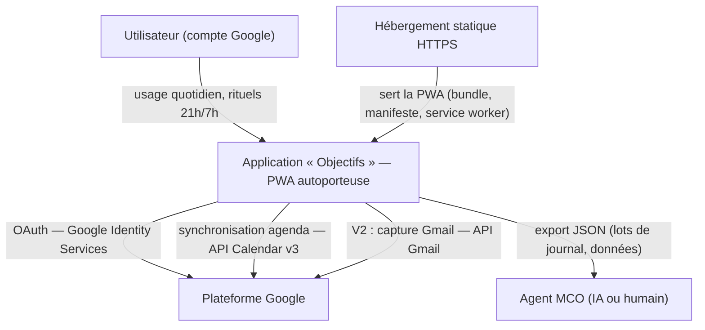
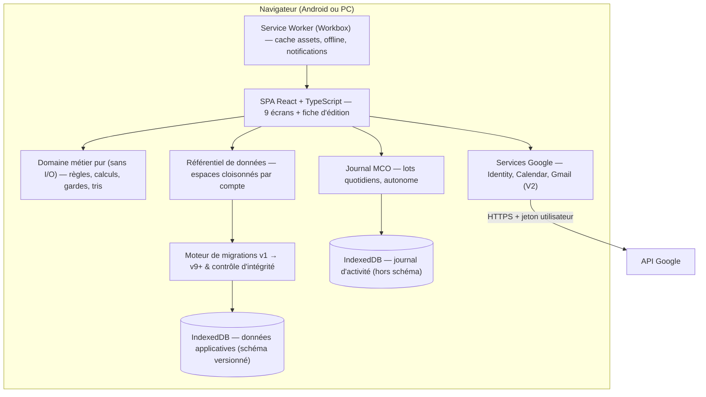
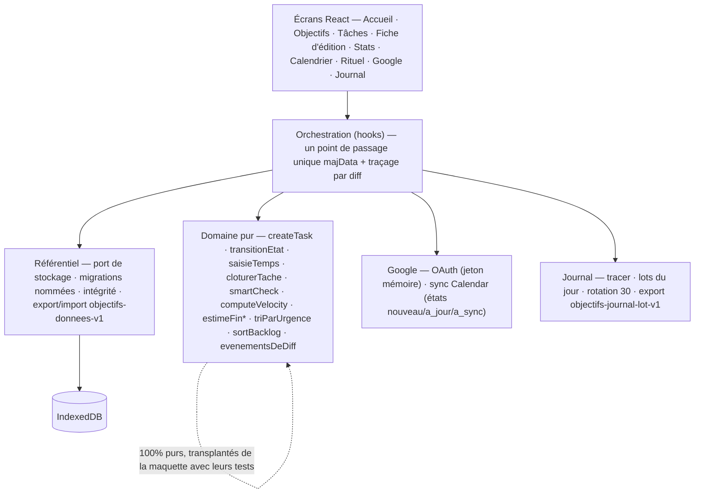
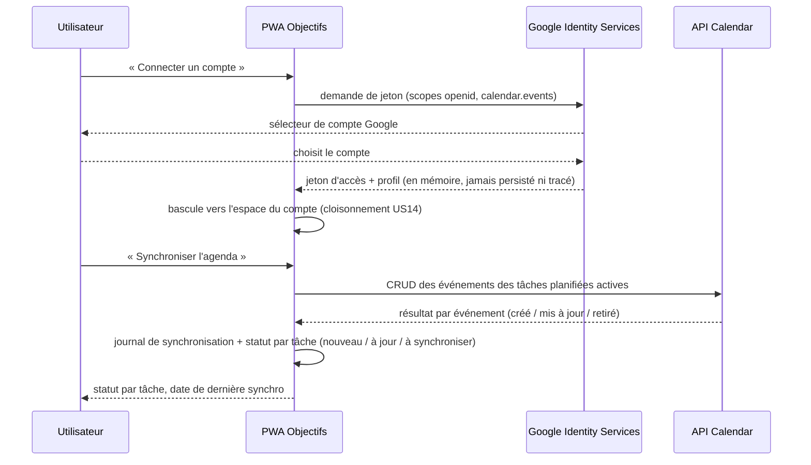
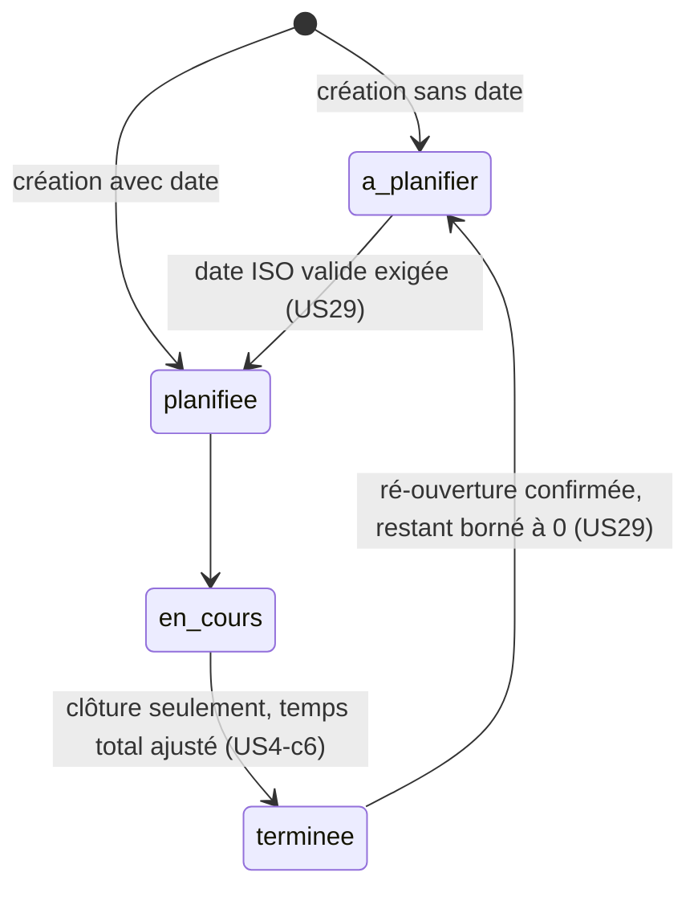
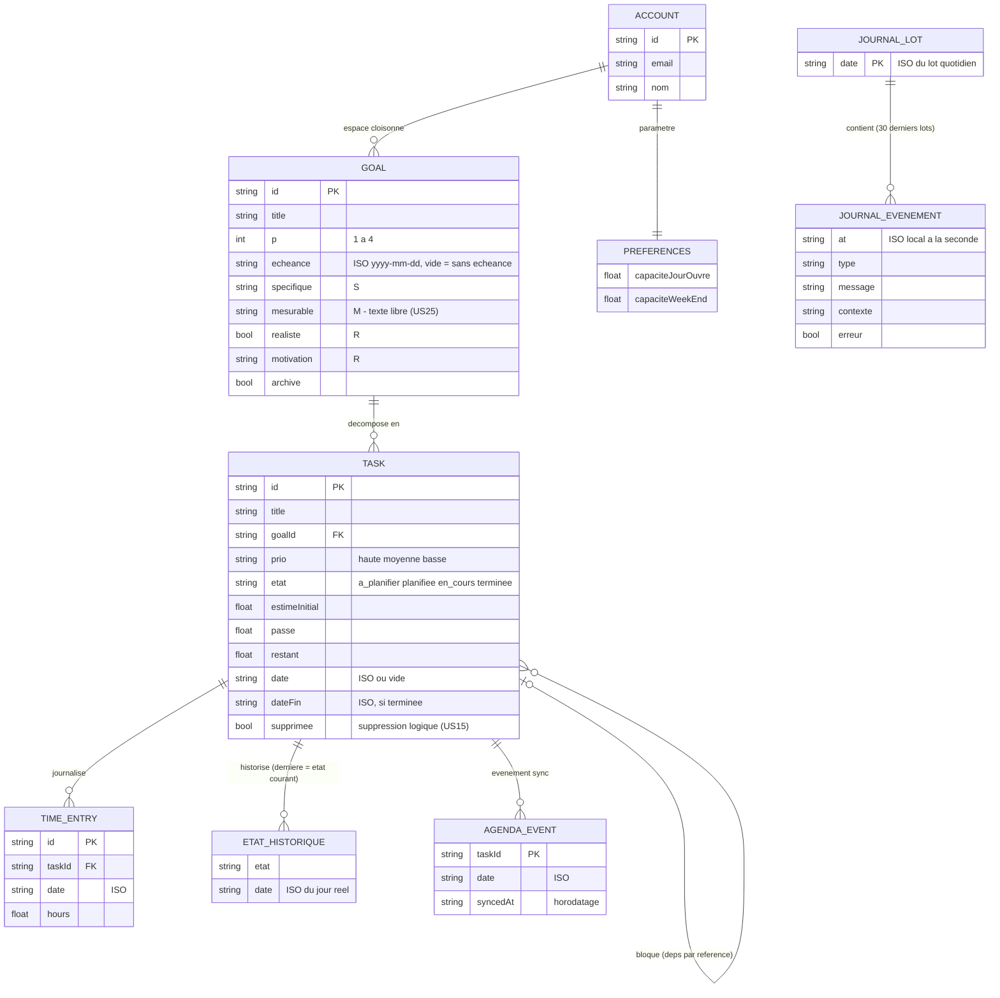
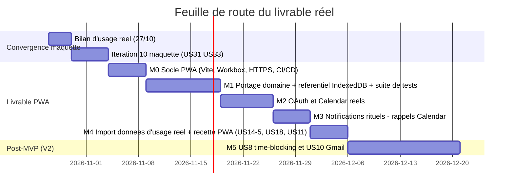

# Dossier d'Architecture Technique — Application « Objectifs »

> **Version** : v1.1 — v1.0 validée par revue quadripartite · v1.1 : décisions utilisateur D-1/D-2 (persistance distante Google Drive, rappels Calendar), ADR-10..12 · **Date** : 19/10/2026
> **Source d'exigences** : cahier des charges « Application de gestion des tâches » (US1–US33 ; itérations 1 à 9 livrées et recettées ; période d'usage réel en cours, bilan le 27/10/2026 ; maquette de référence v0.11.0, schéma v9).
> **Objet** : architecture du **livrable réel** — application PWA autoporteuse (US18) installable Android et PC, données locales d'abord, intégrations Google réelles (OAuth, Calendar, Gmail en V2), sans perte des données d'usage réel (export/import US23).
> **Statut** : validé (revue quadripartite du 19/10/2026 — responsable technique, développeur, UX/UI, analyste métier ; verdicts et retours consolidés au §11).

---

## 1. Contexte et objectifs

### 1.1 Périmètre

Application **personnelle** de productivité : objectifs SMART décomposés en tâches, priorisation, planification (agenda Google en sortie), backlog, vélocité et prévisions, rituels quotidiens 21h/7h, journal d'activité MCO. Le périmètre du livrable réel couvre :

- tout le périmètre déjà validé sur la maquette (itérations 1–9 : US1–US7, US9, US11–US23, US24–US30, US32) ;
- les éléments non fidélisables sur maquette, explicitement reportés au livrable réel par le cahier : **OAuth Google réel** (US14-5), **API Calendar réelle** (US1-c2), **notifications réelles des rituels** (US11), **packaging PWA installable** (US18) ;
- l'**import des données d'usage réel** produites sur la maquette (export `objectifs-donnees-v1`, US23) — continuité sans ressaisie ;
- en V2 : time-blocking assisté (US8), capture Gmail (US10), bascule multi-comptes à chaud (US14 complet).

### 1.2 Acteurs

| Acteur | Rôle vis-à-vis du système |
|---|---|
| Utilisateur unique (propriétaire des données) | Usage quotidien : objectifs, tâches, rituels, planification, synchronisation agenda |
| Plateforme Google | Fournisseur d'identité (OAuth), du calendrier (API Calendar v3) et, en V2, des messages (API Gmail) |
| Agent MCO (IA ou humain) | Consommateur des lots de journal exportés (`objectifs-journal-lot-v1`, US22) — l'analyse reste hors application |
| Hébergement statique HTTPS | Sert la PWA (bundle + manifeste + service worker) ; ne stocke **aucune** donnée utilisateur |

### 1.3 Besoin reformulé

La maquette React actuelle (v0.11.0, schéma v9) est devenue une **spécification exécutable** : 33 US recettées critère par critère, une logique métier pure couverte par une suite de tests miroir (~190 checks cumulés), un schéma versionné avec 8 migrations éprouvées. Le besoin n'est donc pas de redévelopper, mais de **transporter ce cœur éprouvé vers un support distribuable et intégré** : une PWA installable, utilisable hors ligne, connectée aux vrais services Google de l'utilisateur, avec des notifications fiables aux heures des rituels — tout en garantissant que les données accumulées pendant la période d'usage réel migrent sans perte.

Le besoin implicite derrière la demande : **appropriation des données** (les données appartiennent à l'utilisateur, restent sur son appareil, sortent uniquement vers ses propres services Google) et **autonomie de maintenance** (MCO outillé par le journal, migrations automatiques, build reproductible).

### 1.4 Hors périmètre

Multi-utilisateur et partage, serveur de synchronisation, analyse automatisée des lots MCO dans l'application, langues autres que le français, US8/US10 avant la V2, empaquetage APK comme support principal (option documentée, voir ADR-02/ADR-07).

---

## 2. Exigences

### 2.1 Cas d'usage principaux

1. **Boucle quotidienne** : revue du matin (programme du jour, ajustements) → avancement des tâches (états, saisies de temps à deux champs, clôture avec temps total ajusté) → bilan du soir (saisies, actions de demain, suggestions par urgence).
2. **Gestion d'objectif** : création SMART avec contrôleur en direct → tâches liées → suivi (charge, temps restant, vélocité, date de fin estimée, « à risque », burndown) → clôture/archivage.
3. **Planification** : date via calendrier (ISO), une tâche planifiée = un événement Google Agenda synchronisé (créé/mis à jour/retiré, journalisé).
4. **Comptes** : connexion OAuth Google, espaces de données cloisonnés par compte, bascule sans perte (déconnexion = aucune suppression).
5. **Appartenance des données** : export JSON complet de l'espace actif, import avec migration + intégrité, remise à zéro propre (US23) ; export de lots de journal pour le MCO (US22).

### 2.2 Exigences fonctionnelles clés et traçabilité architecture

| Domaine | US de référence | Réponse architecturale (§) |
|---|---|---|
| Logique métier (tâches, charges, vélocité, SMART, tri, gardes) | US1–US7, US12, US19, US28–US30 | Domaine métier pur transplanté tel quel (§4.2, ADR-04) |
| Persistance, schéma versionné, migrations atomiques, intégrité | US15, US16 | Référentiel IndexedDB + moteur de migrations existant (§4.3) |
| Responsive, accessibilité | US17, US31 | Front unique fluide 320 px → desktop, cibles 44 px, AA (§5) |
| Comptes Google, cloisonnement | US14 (+ complet en V2) | OAuth Google Identity Services, espaces par `accountId` (§4.5) |
| Sync agenda | US1-c2 | Service Calendar (calendrier du compte actif), file d'opérations journalisée (§4.6) |
| Rituels et notifications | US11 | Notifications locales PWA + **rappels Google Calendar natifs** (§5.6, ADR-07/ADR-11) |
| Journal d'activité MCO | US22 | Journal par lots autonome, hors schéma, cloisonné, export JSON (§4.7) |
| Portabilité | US23 | Format `objectifs-donnees-v1`, chaîne de migrations, intégrité avant remplacement (§4.3) |
| Packaging et mise à jour | US18 | PWA statique HTTPS, service worker, versionnage app ↔ schéma (§3, ADR-02) |

### 2.3 Exigences non fonctionnelles (critères qualité attributaires)

- **Disponibilité** : 100 % du périmètre local fonctionne **hors ligne** (offline-first) ; seules la connexion OAuth et la synchronisation Calendar exigent le réseau ; un échec réseau ne perd jamais de données (file locale, resynchronisation).
- **Performance** : interactions < 100 ms (données locales, dérivation à la volée, volumes personnels — quelques milliers d'objets au plus) ; premier rendu < 2 s sur mobile milieu de gamme.
- **Sécurité / confidentialité** : HTTPS exclusif (US18) ; jeton OAuth **en mémoire, jamais persisté ni tracé** (conforme US22) ; scopes minimaux ; aucune donnée envoyée ailleurs qu'aux API Google du compte actif ; CSP stricte ; aucun secret dans le bundle (client OAuth public).
- **Maintenabilité** : domaine métier pur = spécification exécutable testée unitairement ; migrations nommées/idempotentes ; journal des migrations ; build reproductible documenté (US18-c5).
- **Observabilité** : journal d'activité par lots quotidiens, horodaté à la seconde, rotation 30 lots, export 1-clic (US22) — l'outil MCO de référence, conservé à l'identique.
- **Accessibilité** : cibles ≥ 44 px, `aria-label`/`title` systématiques, contraste AA, information jamais portée par la seule couleur (US31, en itération 10 sur la maquette puis transposé).
- **Portabilité** : export/import intégral de l'espace actif ; RPO nul par nature (données locales), sauvegarde à l'initiative de l'utilisateur (export manuel proposé).

---

## 3. Vue d'ensemble de l'architecture

### 3.1 Contexte (niveau 1)



**Lecture** : aucune donnée utilisateur ne transite par l'hébergement ; les API Google sont consommées directement depuis l'appareil de l'utilisateur, avec son jeton, vers ses propres calendriers/messages.

### 3.2 Conteneurs (niveau 2)



### 3.3 Composants internes (niveau 3)



**Couches et dépendances unidirectionnelles** : écrans → orchestration → { domaine pur, référentiel, services Google, journal }. Le domaine pur n'a **aucune** dépendance sortante (pas d'I/O, pas de framework) — c'est lui qui se transpose de la maquette sans modification (ADR-04).

### 3.4 Flux de référence : connexion OAuth puis synchronisation agenda



### 3.5 Cycle de vie d'une tâche (règles et gardes transplantées)



Toute autre transition est refusée avec la règle en cause (cycle strict US29-c1) ; une tâche bloquée (US19) ne peut ni avancer ni être clôturée ; chaque transition alimente l'historique d'états (invariant : dernière entrée = état courant, contrôlé par l'intégrité du schéma).

---

## 4. Architecture « back-end » : services locaux et intégrations

### 4.1 Parti pris : pas de serveur applicatif (ADR-01)

L'application n'a **pas de back-end dédié**. Le « back-end » est une couche de services embarquée dans la PWA : référentiel de persistance, moteur de migrations, contrôleur d'intégrité, services d'intégration Google, journal MCO. Justification : usage strictement personnel, aucune donnée partagée entre utilisateurs, exigence offline-first (US15), distribution statique (US18), confidentialité maximale. Les options BFF (proxy serveur des API Google) et Backend-as-a-Service ont été écartées — comparaison en §6 et ADR-01.

### 4.2 Domaine métier pur (cœur transposé de la maquette)

Toutes les règles métier du cahier vivent dans des fonctions **pures sans I/O**, déjà écrites, testées (~190 checks cumulés en suite miroir) et recettées sur la maquette : création/validation de tâches (US3/US28), saisie de temps et clôture (US4), tris (US5/US30), agrégats et fins estimées (US6/US7/US19), contrôleur SMART (US12), matrice de transitions (US29), diff de traçage (US22). Elles constituent le cœur du livrable et sont transplantées **sans modification fonctionnelle**. Seul changement structurant : l'injection d'une **horloge** (et de l'aléa des ids) là où la maquette appelle `new Date()`/`Date.now()` en dur (ADR-08) — condition de testabilité en environnement standard.

### 4.3 Référentiel de données, migrations, intégrité

- **Port de stockage unique** : lecture/écriture de l'état applicatif complet, espaces **cloisonnés par compte** (`accountId`, US14) ; sémantique identique à la maquette (une clé d'espace, un compte actif en session).
- **Moteur de migrations US16 conservé tel quel** : migrations nommées et numérotées (`v07_v08_mesurable_texte`…), chaînage ordonné, idempotence, atomicité (un échec laisse les données intactes), journal des migrations, contrôle d'intégrité par version (invariants : état courant = dernière entrée d'historique, dates ISO valides, cardinalités, aucun dépendance pendante).
- **Import/export US23** : format `objectifs-donnees-v1` (en-tête de contexte + données de l'espace actif, compte exclu) ; l'import enchaîne migration → intégrité **avant** remplacement ; les 4 refus propres (illisible, format, schéma supérieur, intégrité) restent de mise. C'est ce mécanisme qui assurera la **continuité maquette → livrable réel** : export du 27/10 importé dans la PWA.

### 4.4 Modèle de données (schéma v9, ISO)



**Notes de modélisation** (conformes US15) : identifiants stables ; relations **par référence** (ids), jamais par imbrication ; listes embarquées (`historiqueEtat`, `deps`) portées par la tâche ; **aucune valeur calculée stockée** (charges agrégées, vélocité, fins estimées, scores SMART = dérivations) ; suppression **logique** dès que des données alimentent l'historique ; le journal est **hors schéma** (stockage autonome, jamais contrôlé par l'intégrité — US22). Trois ensembles stockés séparément : données applicatives (par espace), journal d'activité (par espace), préférences du rituel/faits du jour (hors schéma, US11/US21).

### 4.5 Authentification et autorisations

- **Google Identity Services (GIS)**, flux token côté client : l'application est un **client OAuth public** (pas de secret embarqué — il n'y a rien à dérober dans le bundle).
- **Scopes minimaux** : `openid` (identité), `calendar.events` (agenda du compte actif) ; en V2 seulement : lecture Gmail restreinte (US10). Aucun scope d'écriture Gmail.
- **Jeton d'accès en mémoire uniquement** : jamais persisté (IndexedDB/localStorage), jamais journalisé (règle de confidentialité US22) ; renouvellement silencieux à la reconnexion ; expiration gérée par re-prompt explicite.
- **Autorisations = cloisonnement** : toutes les opérations de données agissent sur l'espace du compte actif ; aucune requête Google n'est émise sans compte connecté (refus explicite, US1-c2-1).

### 4.6 Intégration Google Agenda (et Gmail en V2)

- **Contrat** : une tâche **planifiée active** = un événement du calendrier du compte actif (titre, date ISO réelle, charge restante) ; mise à jour si la date change ; retrait si terminée/supprimée/déplanifiée ; chaque opération journalisée (créé/mis à jour/retiré + horodatage) ; statut par tâche (`hors_agenda`/`nouveau`/`a_jour`/`a_sync`) et date de dernière synchronisation (US1-c2).
- **File de synchronisation locale** : la synchronisation est **idempotente et rejouable** (re-sync immédiate = aucune opération, critère US1-c2-2) ; hors ligne, les opérations attendent la prochaine demande de synchronisation — aucune perte, l'état dérivé est reconstitué à la volée depuis les tâches.
- **V2 — time-blocking (US8)** : lecture des créneaux libres (`freebusy`/`events`) + suggestions priorisées par urgence (US30) — même service, endpoints additionnels.
- **V2 — Gmail (US10)** : capture d'un email en tâche (objet = titre, deep lien conservé) + récap hebdomadaire dérivé des données locales.

### 4.7 Journal d'activité MCO (US22)

Conservé à l'identique de la maquette : événements horodatés à la seconde, catalogue v1 complet, lots quotidiens avec rotation des 30 derniers, stockage **autonome hors schéma** cloisonné par compte, échec **silencieux** (le journal ne peut jamais bloquer ni altérer l'application), export JSON 1-clic `objectifs-journal-lot-v1` (en-tête de contexte + reprise des journaux migrations/sync sans duplication). C'est l'outil d'observation de la production ; aucun service tiers d'analyse d'erreur n'est introduit (confidentialité — ADR-01).

---

## 5. Architecture front-end

### 5.1 Framework et justifications

**React 18 + TypeScript, build Vite, styles Tailwind** (ADR-05). Continuité directe avec la maquette : composants d'écran, patterns d'interaction (panneaux inline, confirmations en deux clics, refus avec règle affichée) et vocabulaire visuel se transplantent. TypeScript strict garantit les contrats du schéma v9. Vite produit un bundle statique optimisé (pas de serveur de rendu — un site statique suffit, US18).

### 5.2 Structure du code

```
src/
  domain/        # fonctions métier pures + types du schéma (transposées de la maquette, testées)
  storage/       # référentiel (IndexedDB), migrations, intégrité, export/import
  google/        # OAuth (GIS), Calendar, (V2) Gmail — jetons en mémoire
  journal/       # journal MCO : lots, rotation, export
  clock/         # service d'horloge/aléa injecté (ADR-08)
  screens/       # 9 écrans + fiche d'édition (US27) + composants partagés
  app/           # composition, navigation, contexte d'espace actif, majData (traçage par diff)
```

### 5.3 État et dérivation

- **État local React + contexte léger** (compte actif, espace de données) ; **pas de store global** (ADR-06) : l'application est mono-utilisateur, les volumes sont personnels, et le cahier impose la dérivation à la volée (US15-c3 : une valeur calculée est dérivée, jamais dupliquée en dur) — vélocité, SMART, backlog, fins estimées se recalculent à chaque changement, exactement comme sur la maquette.
- **Point de passage unique** `majData(next)` : applique la modification d'état, déclenche le traçage par diff (`evenementsDeDiff` — pure), puis persiste. Un seul chemin d'écriture = cohérence du journal et des migrations garantie.

### 5.4 Navigation

Navigation par **onglets supérieurs** (décision d'usage : « pills » en haut, zone basse réservée aux soft buttons Android) + **détail d'objectif empilé** dans l'onglet Objectifs + **fiche d'édition de tâche en overlay plein écran** (US27) — pas de routeur d'URL : l'application est installable, mono-fenêtre, et l'historique de navigation natif n'apporte rien à ces parcours. Le service worker sert la dernière version au prochain lancement (US18).

### 5.5 Accessibilité, i18n, responsive

- **US17/US31** : fluide de 320 px au desktop ; cibles tactiles ≥ 44 px ; `aria-label` + `title` sur tout bouton-icône ; contraste AA ; état identifiable sans la couleur ; focus visible.
- **i18n : aucune** — français seul (ADR-09) ; vocabulaire figé par le cahier (états, priorités, durées en heures décimales ; US33 prévoit le format lisible « 2 h 30 » en itération 10).

### 5.6 Notifications des rituels (US11) — point d'attention

Modèle recommandé : **notifications locales PWA** via le service worker (Web Notifications API), avec le constat honnête : sans serveur de push, une PWA ne peut pas garantir un réveil exact à 21h/7h sur tous les appareils (limites d'arrière-plan des navigateurs mobiles, notamment iOS). Stratégie en trois paliers (ADR-07) :

1. **Au premier plan** : notification immédiate à l'heure du rituel si l'app est ouverte (timer) ;
2. **À la réouverture** : notification de rattrapage au premier lancement du jour si le rituel du soir/matin n'a pas été fait (dérivé des données — robuste partout) ;
3. **Rappels Google Calendar natifs** *(décision D-2 du 19/10/2026 — ADR-11)* : le rituel du matin/du soir est matérialisé en événements récurrents du calendrier Google (heures et activations déjà portées par les préférences du rituel) ; l'application Calendar livre des rappels fiables au niveau OS. **L'option TWA/APK est écartée** — pas d'empaquetage à maintenir, pas de serveur (ADR-01 tenu).

Le **rattrapage à la réouverture** (palier 2) et le **guide d'installation PWA** au premier lancement s'appuient sur les états vides guidés et la carte « Bienvenue — 3 étapes » de l'US33 (itération 10) : un même design de guidage sert l'installation, le premier usage et le rattrapage des rituels *(retour UX/UI consolidé en revue v1.0)*.

---

## 6. Choix technologiques

| Axe | Options envisagées | Sélection | Justification |
|---|---|---|---|
| Modèle d'architecture | (a) Statique + API Google depuis le client · (b) BFF léger (proxy OAuth/Calendar) · (c) Backend-as-a-Service (Firebase) | **(a)** | Données 100 % personnelles, offline-first (US15), distribution statique (US18) ; (b) ajoute un serveur à exploiter sans aucun partage inter-utilisateurs à servir ; (c) fait sortir les données de l'appareil sans besoin — contraire à l'esprit d'appropriation (ADR-01) |
| Support de livraison | (a) PWA · (b) Natif Kotlin/Compose · (c) TWA/APK | **(a)**, (c) en option notifications | Décision utilisateur consignée US18 : PWA installable Android + PC, hébergement statique, mises à jour automatiques ; (b) écarté (double développement, perte de la continuité maquette) |
| Stockage local | (a) localStorage · (b) IndexedDB · (c) SQLite/WASM | **(b)** | localStorage = limite ~5 Mo, API synchrone bloquante, adaptée à la maquette seulement ; IndexedDB : asynchrone, quotas larges, transactions — derrière le **même port de stockage** que la maquette (sémantique inchangée, ADR-03) |
| Front-end | (a) React+TS+Vite · (b) Next.js · (c) SvelteKit | **(a)** | Continuité totale avec la maquette (spécification exécutable transplantable), pas de SSR nécessaire, build statique simple (ADR-05) |
| Gestion d'état | (a) État React + contexte · (b) Redux/Zustand | **(a)** | Mono-utilisateur, dérivation imposée par US15-c3 ; un store global dupliquerait l'état pour rien (ADR-06) |
| PWA tooling | (a) Workbox · (b) Service worker manuel | **(a)** | Precaching, stratégies de cache et notifications éprouvées ; le SW manuel est un risque de bugs silencieux pour l'offline |
| Notifications | (a) Locales PWA + rattrapage · (b) Push serveur · (c) TWA · (d) Rappels Google Calendar | **(a)** puis **(d)** | (b) imposerait un serveur — contraire à ADR-01 ; (c) TWA écartée (décision D-2, 19/10) : les rappels Calendar couvrent le réveil exact sans empaquetage ; voir §5.6 et ADR-07/ADR-11 |
| Tests | (a) Vitest (domaine + référentiel) + Playwright E2E · (b) Jest | **(a)** | Suite miroir existante transplantée telle quelle (ADR-04) ; fake-indexeddb pour le port de stockage |

---

## 7. Qualité et non-fonctionnel

### 7.1 Stratégie de tests (continuité de la discipline projet)

- **Domaine pur** : la suite miroir (54 checks itération 9 + régressions cumulées itérations 1–8) devient la suite **unitaire Vitest** du livrable — les fonctions étant transplantées telles quelles, les attendus sont déjà écrits et passants.
- **Référentiel** : tests d'intégration sur fake-indexeddb (migrations chaînées v1→v9, intégrité, refus propres, round-trip export/import US23, cloisonnement des espaces).
- **E2E (Playwright)** : parcours boucle quotidienne (rituel soir → planification → revue du matin), création SMART → clôture, connexion/synchronisation (API Google mockées).
- **Règle projet conservée** : un échec de test se diagnostique d'abord comme défaut de harnais, ensuite comme défaut de code — chaque itération consigne échec → cause → correctif.
- **Recette métier** : le protocole du cahier (parcours critère par critère, scénarios bout-en-bout, tests des limites) rejoué sur le livrable réel pour les US non fidélisables sur maquette (US14-5, US1-c2 réel, US11 réel, US18).

### 7.2 CI/CD et environnements

Chaîne GitHub Actions : `lint + typescript → tests (Vitest) → build (Vite + Workbox, version semver) → déploiement statique HTTPS (ex. GitHub Pages/Cloudflare Pages)`. Deux environnements : `preview` (branche) et `prod` (tag). Le build est reproductible (même sources → même version, US18-c5) ; version applicative (semver) et version de schéma restent **distinctes** avec correspondance documentée au journal des migrations (US18, discipline US16/A5). **Restauration/rollback (exigence responsable technique, US18-c4)** : un déploiement n'est actif qu'après la validation du contrôle d'intégrité post-migration au premier lancement ; en cas de mise à jour interrompue ou de bundle corrompu, le service worker continue de servir la **dernière version valide en cache** et les données locales restent lisibles par elle — aucun déploiement ne peut détruire des données ; la procédure de retour arrière (re-tag de la version précédente) est documentée dans le build.

### 7.3 Sécurité

HTTPS exclusif + HSTS ; CSP stricte (self + API Google autorisées) ; client OAuth public sans secret embarqué ; jeton en mémoire, jamais tracé (US22) ; scopes minimaux ; aucune télémétrie tierce ; validation systématique des entrées (contrôles US28) et intégrité des données au chargement (US16) — y compris sur données importées (US23).

### 7.4 Performance

Volumes personnels (quelques milliers d'objets maximum) : dérivation à la volée suffisante, pas de virtualisation au MVP ; code splitting par écran ; cache assets par Workbox (precache) ; Lighthouse cible : PWA installable, LCP < 2 s sur mobile.

### 7.5 Observabilité

Le journal US22 (lots quotidiens, erreurs en évidence, export MCO) est l'unique canal — volontairement : pas de télémétrie externe (confidentialité). Le protocole MCO en usage réel (export du lot du jour → analyse par l'agent MCO) est déjà opérationnel et documenté au cahier. **Sauvegarde (exigence responsable technique)** : les données n'existant que localement (ADR-01), l'application rappelle périodiquement à l'utilisateur d'exporter ses données (format `objectifs-donnees-v1`, US23) — rappel discret paramétrable, adossé au journal (période écoulée depuis le dernier export) ; l'export manuel reste possible à tout moment.

---

## 8. Risques et mitigations

| # | Risque | Gravité | Mitigation |
|---|---|---|---|
| R1 | **Notifications rituels non garanties en arrière-plan** (limites PWA mobiles, US11) | Majeure (périmètre explicite du livrable) | Stratégie 3 paliers (§5.6) : notification au premier plan, rattrapage à la réouverture (dérivé des données — fiable partout) ; palier 3 **clos le 19/10/2026 (décision D-2) : rappels Google Calendar natifs (ADR-11)** — option TWA écartée |
| R2 | **Sémantique localStorage → IndexedDB** (asynchrone, transactions) | Moyenne | Port de stockage unique (même contrat que la maquette), tests d'intégration dédiés, round-trips US23 rejoués ; import des données de la maquette via US23 (pas de double stockage) |
| R3 | **OAuth client public** (pas de jeton de rafraîchissement serveur) | Moyenne | Renouvellement silencieux GIS au lancement ; re-prompt explicite à l'expiration ; jeton jamais persisté — au pire, l'utilisateur re-sélectionne son compte (aucune donnée perdue, US14-c3) |
| R4 | **Quotas API Calendar** | Faible | Usage personnel : quotas gratuits largement suffisants ; synchronisation à la demande (pas de polling) |
| R5 | **Divergence comportementale maquette → livrable** | Moyenne | Le domaine pur et ses tests se transplantent sans réécriture ; recette croisée maquette/PWA sur les mêmes scénarios du cahier ; les mêmes données de démonstration/d'usage alimentent les deux |
| R6 | **Perte de données en production** (critère de sortie MVP) | Majeure | Mécanisme éprouvé : migrations atomiques + intégrité au chargement + suppression logique ; export manuel proposé (US23) ; journal US22 fournit la traçabilité de diagnostic |
| R7 | **Changement de jour / horloge** (US22, réserve maquette) | Faible | Détection au premier rendu après minuit (idem maquette) ; les notifications (R1 palier 1-2) fiabiliseront le réveil de l'application |
| R8 | **Dette de couplage horloge/aléa** (`new Date()` en dur dans les fonctions de la maquette) | Faible | ADR-08 : injection d'un service d'horloge au portage — changement mécanique, couvert par les tests transplantés |

---

## 9. Décisions d'architecture (ADR)

**ADR-01 — Architecture sans back-end applicatif.** Contexte : usage strictement personnel, offline-first, hébergement statique (US15/US18). Options : statique + API Google côté client / BFF / Backend-as-a-Service. **Décision : statique, aucun serveur.** Les données ne quittent jamais l'appareil (hors API Google de l'utilisateur) ; coût et surface de sécurité minimaux ; l'inconvénient (pas de synchronisation multi-appareils) est hors besoin actuel — à rouvrir si le besoin apparaît (le format d'export US23 garantit la portabilité entre appareils). *Amendé le 19/10/2026 (décision D-1) : le besoin est apparu et est résolu **sans serveur applicatif** — persistance distante via Google Drive (ADR-10) ; l'architecture sans back-end reste tenue.*

**ADR-02 — PWA comme support principal (décision utilisateur, US18).** Options : PWA / natif Kotlin / TWA. **Décision : PWA installable Android + PC**, hébergement statique HTTPS, service worker ; TWA/APK conservé comme **option** pour les notifications exactes (ADR-07) — même code applicatif.

**ADR-03 — IndexedDB derrière un port de stockage unique.** Options : localStorage (maquette) / IndexedDB / SQLite WASM. **Décision : IndexedDB** (asynchrone, quotas, transactions), enveloppé dans le même contrat de référentiel que la maquette (espaces cloisonnés, migrations, intégrité) — le reste du code ignore le support.

**ADR-04 — Le domaine métier pur de la maquette est la spécification exécutable du livrable.** Options : réécrire / transplanter. **Décision : transplanter à l'identique** les fonctions pures (et leur suite de tests) — 33 US recettées, ~190 checks : réécrire reviendrait à réintroduire du risque pour zéro gain. Toute évolution métier future reste spécifiée d'abord sur le couple cahier + maquette (le processus en place), puis transplantée.

**ADR-05 — React 18 + TypeScript + Vite + Tailwind.** Continuité avec la maquette (composants et patterns transplantables, équipe = l'utilisateur et ses agents) ; SPA sans SSR (site statique) ; Vite pour un build rapide et reproductible.

**ADR-06 — Pas de gestionnaire d'état global.** US15-c3 impose la dérivation (jamais de duplication) ; mono-utilisateur ; un point de passage unique d'écriture (`majData`) suffit à garantir cohérence + traçage.

**ADR-07 — Notifications locales sans serveur de push.** Options : locales + rattrapage / push serveur / TWA. **Décision : palier 1-2 locaux** (premier plan + rattrapage à l'ouverture, robuste car dérivé des données), TWA en palier 3 si le réveil exact est exigé. Un serveur de push pour un utilisateur unique contredirait ADR-01. *Amendé le 19/10/2026 (décision D-2) : le palier 3 (TWA) est remplacé par les rappels Google Calendar natifs — voir ADR-11.*

**ADR-08 — Injection d'horloge, d'aléa et déport des effets de bord.** La maquette appelle `new Date()`/`Date.now()`/`Math.random()` dans certaines fonctions (ids, horodatages de saisie). **Décision : service `clock` injecté** au portage — les fonctions deviennent entièrement déterministes sous test, sans changement de comportement. Complément issu de la revue développeur (v1.0) : les **effets de bord directs** de la maquette — écritures `localStorage` du journal MCO (US22), des préférences du rituel (US11) et des faits du jour (US21) — sont **déportés derrière les ports `storage`/`journal`** (aucun accès au support hors des ports), sans changer leur sémantique (stockage autonome hors schéma, échec silencieux).

**ADR-09 — Pas d'i18n, pas de librairie CSS additionnelle.** Français seul (cahier intégralité en français, vocabulaire métier figé) ; Tailwind existant suffit (déjà conforme aux décisions visuelles consignées).

**ADR-10 — Persistance distante optionnelle via Google Drive `appDataFolder` (décision utilisateur D-1, 19/10/2026).** Contexte : besoin apparu de sauvegarde centralisée et de synchronisation multi-appareils (étude de faisabilité v1.1). Options : statu quo (export manuel US23) / Worker + D1 Cloudflare / Drive `appDataFolder` / BaaS. **Décision : Drive `appDataFolder`** — aucune infrastructure à exploiter, continuité directe avec l'OAuth de M2 (§4.5), état répliqué au format d'export US23, synchronisation par polling `modifiedTime` + « dernier écrivain » atténué par l'historique de révisions Drive. L'app reste pleinement fonctionnelle hors ligne (ADR-01 inchangé) : la couche distante est un **adaptateur optionnel derrière le port de stockage** (ADR-03), jamais une source de vérité obligatoire. RGPD : les données transitent chez Google — accepté par le client, écosystème déjà en périmètre (§4.5/4.6). Phasage post-MVP : V2-S1′ sauvegarde (~2–3 j) → V2-S2′ synchronisation (~3–5 j).

**ADR-11 — Rappels Google Calendar comme canal des notifications des rituels (décision utilisateur D-2, 19/10/2026 ; amende ADR-07).** Options : TWA/APK / push serveur (Web Push) / rappels Calendar natifs. **Décision : rappels Calendar** — le rituel du matin/du soir est matérialisé en événements récurrents du calendrier Google (heures et activations déjà portées par les préférences du rituel, US11) ; l'application Calendar livre des rappels fiables au niveau OS. Aucun empaquetage à maintenir (TWA écartée), aucun serveur (ADR-01 tenu). **Calendar est un canal de notification et d'affichage, jamais un stockage du domaine.** Paliers 1-2 locaux PWA conservés (premier plan + rattrapage). Mise en œuvre au M3, en continuité de M2 (OAuth + Calendar réels).

**ADR-12 — OAuth Google « en production » dès M2 (cycle des jetons).** Contexte : en statut « Testing », les jetons d'actualisation Google expirent tous les 7 jours — incompatible avec un usage quotidien. **Décision : publier l'écran de consentement OAuth « En production » au M2** ; pour un usage personnel (< 100 utilisateurs), l'avertissement « application non vérifiée » reste franchissable sans audit de sécurité complet. Les jetons d'accès/rafraîchissement sont stockés derrière le port `storage` (ADR-08), jamais dans le code source (guide §4.6).

---

## 10. Roadmap de mise en œuvre

Prérequis : bilan de la période d'usage réel (**27/10/2026**) et itération 10 de la maquette (US31/US33 — design/accessibilité et durées lisibles), conformément à la priorisation du cahier (le design passe en dernier pour éviter le double travail).



| Jalon | Livrable | Critère de sortie |
|---|---|---|
| M0 | Socle PWA installable, build reproductible, CI/CD | US18-c1/c5 : installation navigateur vierge, procédure de build documentée rejouable ; **arbitrage notifications rendu (R1)** |
| M1 | Application complète sur IndexedDB, domaine pur + tests transplantés | Suite de tests unitaires/intégration passante (équivalente miroir) ; round-trip export/import |
| M2 | OAuth + synchronisation Calendar réelles | US14 (dont critère 5) et US1-c2 recettés sur le réel |
| M3 | Notifications rituels via rappels Google Calendar (ADR-11) | US11 recetté sur l'appareil cible (rappels natifs Calendar) |
| M4 | Données d'usage réel importées, recette finale | Import de l'export du 27/10 sans perte ; critère de sortie MVP (recette livrable + 2 semaines d'usage réel documentées) |
| M5 | V2 : time-blocking, Gmail | US8/US10 recettés |

**Dépendances** : M1 dépend de l'achèvement de l'itération 10 (état final de la spécification) ; M4 dépend de l'export de fin de période ; M3 dépend de M2 (OAuth + Calendar réels) — **arbitrage R1 clos le 19/10/2026** (décision D-2 : rappels Calendar, ADR-11) ; M5 dépend de l'acceptation du MVP.

**Évolution V2 actée (décision D-1 du 19/10/2026 — ADR-10)** : après acceptation du MVP, sauvegarde centralisée puis synchronisation multi-appareils via Google Drive `appDataFolder` — phasage **V2-S1′ sauvegarde (~2–3 j) → V2-S2′ synchronisation par polling (~3–5 j)**, en continuité de M2 (même OAuth, publication « production » requise — ADR-12). À affiner au bilan du 27/10 au vu de l'usage réel.

---

## 11. Validation du DAT (revue quadripartite — 19/10/2026)

**Revue conduite après l'intégration du rôle de responsable technique au cycle projet.** Chaque partie prenante a relu le DAT v0.1 selon son axe ; les retours ont été consolidés et intégrés ; le DAT passe en **v1.0 validé**.

| Partie prenante | Axe de revue | Verdict | Retours consolidés |
|---|---|---|---|
| Responsable technique | Cohérence globale, faisabilité, budget | **Validé avec exigences** (intégrées) | ADR-01 tenu (offline-first, coût nul) ; arbitrage notifications R1 avancé à M0 (§8, §10) ; stratégie de restauration/rollback explicite en CI/CD (§7.2, US18-c4) ; rappel d'export périodique pour le risque « données locales uniquement » (§7.5) |
| Développeur | Implémentation, outillage, testabilité | **Validé avec précision** (intégrée) | Transplantation du domaine pur réaliste (ADR-04) ; ADR-08 élargi : déport des effets de bord `localStorage` (journal US22, préférences US11, faits US21) derrière les ports `storage`/`journal` — sans changement de sémantique |
| Agent UX/UI | Interactions, design system, accessibilité | **Validé avec remarque** (intégrée) | Rattrapage des rituels et guide d'installation PWA adossés aux états vides guidés / carte « Bienvenue » de l'US33 (§5.6) ; US31/US33 en itération 10 avant transposition confirmés |
| Analyste métier | Adéquation au besoin, règles de gestion | **Validé sans réserve** | Aucune contradiction avec le cahier : cycle strict US29, cloisonnement US14, discipline versionnage US18, continuité des données d'usage réel (format US23, jalon M4), positionnement de l'itération 10 avant le livrable réel |

**Changements consolidés en v1.0** : (1) arbitrage R1 exigé avant fin M0 ; (2) rollback/restauration explicite (§7.2) ; (3) rappel d'export périodique (§7.5) ; (4) ADR-08 élargi aux effets de bord (§9) ; (5) guidage installation/rattrapage adossé à l'US33 (§5.6). Aucune objection bloquante ; aucun arbitrage conflictuel à soumettre.

**Point d'arbitrage utilisateur ouvert** (non bloquant pour la validation) : stratégie de notifications (paliers locaux PWA vs option TWA — R1), à trancher avant la fin du jalon M0. **— Clos le 19/10/2026 : rappels Google Calendar (décision D-2, ADR-11) ; TWA écartée.**

**ADR-13 — Outillage du socle M0 : build Node zéro dépendance (amende la roadmap §10, 20/10/2026, validation de la conception US34).** Options : Vite + Workbox (prévus au M0 par la roadmap v1.0) / build Node natif zéro dépendance. **Décision : build Node zéro dépendance** pour le socle M0 — la rejouabilité bit à bit du build (US34-c1, I2) est triviale à garantir sans chaîne d'outillage externe (pas de lockfile, pas de transpilation, pas de plugin dont les versions varient) ; la génération des icônes par encodeur pur Node supprime tout asset binaire ; le service worker (≈ 40 lignes) rend Workbox superflu au M0. Réévaluation prévue au M1/M2 si la complexité du portage (routing, bundling des 33 US) justifie Vite ; Workbox réévaluable si la stratégie de cache se complexifie au M2. Conforme ADR-01 (statique, coût nul) et ADR-02 (versionnage app ↔ schéma : cache SW versionné par version d'app).

**ADR-14 — Suite BDD Gherkin zéro dépendance (décision client du 20/10/2026, cycle v5).** Options : Cucumber-js (dépendance + wire-up ESM) / mini-runner Gherkin pur Node /Playwright-or-Cucumber later. **Décision : mini-runner Gherkin natif** (~100 lignes : parseur `Fonctionnalité/Scénario/Étant donné/Quand/Alors/Et`, moteur de step definitions par expressions régulières, contexte partagé par scénario, code de sortie non nul en échec) — cohérent avec ADR-13 (zéro dépendance, rejouabilité), suffisant pour le périmètre (scénarios fonctionnels du domaine et du livrable). Les `.feature` sont rédigées par l'analyste métier (spécification exécutable), les step definitions par le développeur ; la suite de toutes les `.feature` livrées constitue la **non-régression fonctionnelle**, exécutée à chaque build de test. Réévaluation Cucumber-js/Playwright prévue au M1 si le portage exige des scénarios navigateur réels (E2E UI) — auquel cas un ADR d'amendement sera requis.

### Revue quadripartite de la v1.1 (19/10/2026 — décisions D-1/D-2)

| Partie prenante | Axe de revue | Verdict | Retours consolidés |
|---|---|---|---|
| Responsable technique | Cohérence, faisabilité, sécurité | **Validé** | ADR-01 tenu (aucun serveur applicatif) ; cycle des jetons OAuth traité par ADR-12 (publication « production » au M2, jetons derrière le port `storage`) ; dégradation gracieuse exigée : l'app reste 100 % fonctionnelle si les services Google sont indisponibles |
| Développeur | Implémentation, testabilité | **Validé** | Pas de CI supplémentaire (pas de Worker) ; polling sur `modifiedTime` + révisions Drive pour les conflits ; adaptateur Drive testé au même niveau que le port IndexedDB |
| Agent UX/UI | Interactions, accessibilité | **Validé** | Un seul canal de notification que l'utilisateur connaît déjà (Calendar) ; préférences du rituel réutilisées telles quelles ; consentements Google explicites ; statut de synchronisation discret |
| Analyste métier | Adéquation au besoin | **Validé sans réserve** | US11 fonctionnellement inchangée ; vocabulaire et règles de gestion intacts ; décision D-1 anticipée par rapport au bilan du 27/10 — phasage V2 à re-confirmer au bilan |

**Changements consolidés en v1.1** : (1) ADR-10 persistance distante Drive (décision D-1) ; (2) ADR-11 rappels Calendar (décision D-2, amende ADR-07, clôt le risque R1) ; (3) ADR-12 OAuth production ; (4) §5.6 palier 3, §2/§6/§8 mis en cohérence ; (5) roadmap : M3 via rappels Calendar, note V2 actée. Aucune objection bloquante.

*Historique des versions :*
- *v0.1 (19/10/2026) — brouillon initial, établi à partir du cahier des charges (US1–US33) et de l'état de la maquette v0.11.0 (schéma v9).*
- *v1.0 (19/10/2026) — revue quadripartite (responsable technique, développeur, UX/UI, analyste métier) : quatre validations, cinq retours consolidés listés ci-dessus ; DAT validé.*
- *v1.3 (20/10/2026) — **ADR-14** : suite BDD Gherkin zéro dépendance (mini-runner Node natif) — les `.feature` (analyste) + step definitions (dev) forment la non-régression fonctionnelle exécutée à chaque livraison ; cycle de développement v5 (BDD/TDD) acté au guide v1.6. Archivé dans la bibliothèque d'historique.*
- *v1.2 (20/10/2026) — première application du cycle de développement v4 : **validation de la conception US34 (socle M0) par l'architecte** — verdict « Conformité avec réserves » levées par **ADR-13** (build Node zéro dépendance au M0, amendement de la roadmap §10 « Vite/Workbox ») ; intégration de l'exigence desktop du jalon M0 (arbitrage R1 du 20/10 : installable et fonctionnel sur navigateur de PC, en plus de mobile) ; cache SW versionné par version d'app (ADR-02). Archivé dans la bibliothèque d'historique.*
- *v1.1 (19/10/2026) — décisions utilisateur D-1 (persistance distante Google Drive — ADR-10) et D-2 (rappels Calendar — ADR-11, clôt R1 ; TWA écartée) ; ADR-12 (OAuth production au M2) ; §2/§5.6/§6/§8 mis en cohérence ; roadmap ajustée (M3 rappels Calendar, V2 actée) ; revue quadripartite v1.1 : quatre validations ; archivé dans la bibliothèque d'historique.*