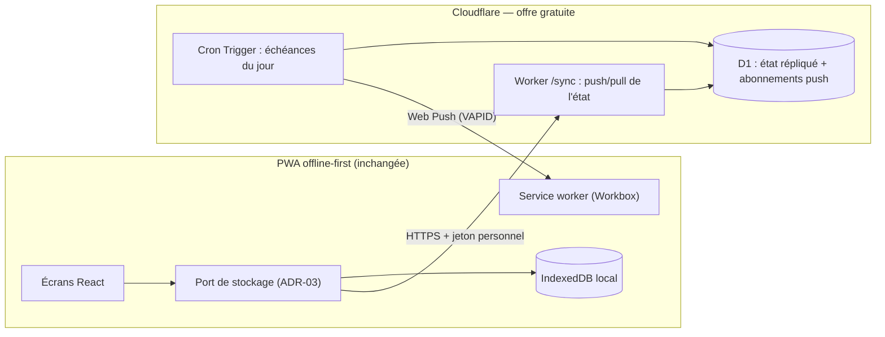
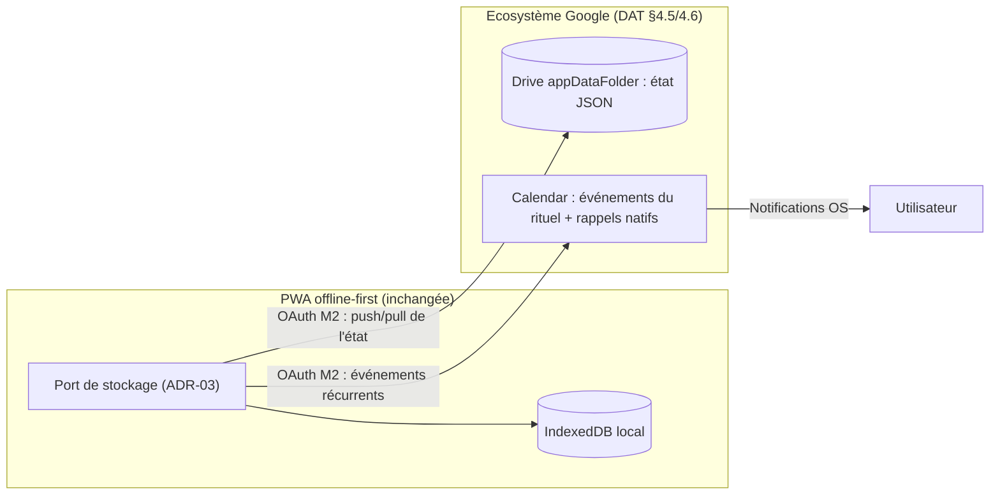

# Étude de faisabilité — Passage à une architecture client-serveur pour « Objectifs »

**Statut** : v1.2 — décisions rendues : **D-1 = Option E (Google Drive + Calendar)** et **D-2 = rappels Calendar (E2)**, actées par le client le 19/10/2026 ; reprise dans le DAT v1.1 (ADR-10/11/12).
**Émetteur** : Architecte logiciel — 19/10/2026
**Référentiels** : DAT v1.0 (ADR-01..09) ; cahier des charges US1–US33 ; guide de bonnes pratiques dev v1.1 ; maquette v0.11.0 (schéma v9).
**Motivations exprimées par le client** : sauvegarde centralisée + synchronisation multi-appareils + notifications fiables (clôturer le risque R1). **Contraintes** : hébergement strictement gratuit (limites acceptées) ; horizon à décider selon la conclusion.

---

## 1. Contexte et besoin reformulé

L'architecture actuelle (ADR-01) est une **PWA statique offline-first sans back-end** : toutes les données vivent sur l'appareil (IndexedDB à terme, `localStorage` en maquette), ce qui expose au risque R2 (« données locales uniquement ») et ne permet pas de notifications fiables en arrière-plan (risque R1, arbitrage attendu avant fin M0).

Le besoin réel derrière la demande n'est pas « un serveur » mais **trois capacités** :
1. **Sécuriser les données** au-delà de l'appareil (sauvegarde centralisée) ;
2. **Retrouver ses données sur plusieurs appareils** (synchronisation) ;
3. **Être notifié de façon fiable** même app fermée (règle définitive du risque R1).

Contraintes structurantes : usage strictement personnel (1 utilisateur), volumes minuscules (Ko–Mo), budget **0 €** avec limites acceptées, exigence de sobriété d'exploitation (pas d'administration serveur quotidienne), données personnelles → **RGPD** (localisation UE souhaitable).

## 2. Options d'architecture envisagées

### Option A — Offline-first conservé + micro-service de synchronisation (recommandée)

La PWA reste la source de vérité locale (ADR-01 inchangé). On ajoute un **service léger distant** chargé de trois rôles : répliquer l'état (sauvegarde), servir de relai entre appareils (synchronisation), et déclencher les notifications (cron + Web Push). Le point d'accroche est déjà prévu par le DAT : **ADR-03 (port/adapter de stockage)** — il suffit d'ajouter un adaptateur distant à côté de l'adaptateur IndexedDB.

### Option B — Client-serveur classique (API REST + base Postgres)

Le stockage migre côté serveur ; le client devient consommateur d'API. Solution plus « standard » mais elle **contredit ADR-01** (offline-first), remet en cause le portage M1 en cours de spécification, et exige une application serveur à maintenir.

### Option C — Backend-as-a-Service (Firebase)

Firestore (NoSQL) + FCM (notifications push gratuites) + Auth. Cohérent avec l'écosystème Google déjà retenu, mais : modèle NoSQL éloigné du modèle document actuel, **les Cloud Functions (nécessaires au moindre traitement serveur) exigent le plan Blaze pay-as-you-go avec carte bancaire**, données hébergées aux États-Unis (RGPD défavorable), verrouillage propriétaire.

### Option D — Auto-hébergement (écartée)

VPS gratuit fiable ou box/Raspberry Pi : écartée — le client n'a pas retenu cette piste ; disponibilité domestique non garantie, maintenance réelle, contradiction avec l'exigence de sobriété.

### Option E — Sans serveur dédié : l'écosystème Google comme « serveur » (ajout v1.1)

Google joue le rôle de serveur, sans aucune infrastructure à déployer ni maintenir, en s'appuyant sur l'OAuth déjà planifié en M2 (DAT §4.5). Deux sous-variantes complémentaires :

**E1 — Google Drive (`appDataFolder`) comme persistance distante.** L'app écrit son état sérialisé (format d'export US23) dans le dossier applicatif caché du compte Google ; chaque appareil pousse/tire l'état à l'ouverture et après changement. Quotas Drive largement suffisants (unités pondérées depuis mai 2026 : lecture 5, écriture 50, liste 100, téléchargement 200 ; ~1 M unités/min par projet et ~325 k par utilisateur — un usage mono-utilisateur en consomme une fraction infime) ; 15 Go inclus. Synchronisation par interrogation (polling sur `modifiedTime`) + « dernier écrivain gagne », atténuée par l'historique de révisions Drive.

**E2 — Google Calendar comme canal de notifications.** Le rituel (programme du matin, revue du soir — **heures et activations déjà portées par les préférences du rituel**) est matérialisé en événements récurrents du calendrier Google avec rapples natifs : l'application Calendar livre des notifications fiables au niveau OS, sans service worker push ni TWA. Réserve d'architecture : Calendar n'est **pas une base de données** — canal de notification et d'affichage uniquement, jamais un stockage du domaine.

**Caveats de l'option E** : (1) jetons OAuth — en statut « Testing » les jetons d'actualisation **expirent tous les 7 jours** ; il faut publier l'app « En production », supportable pour un usage personnel (< 100 utilisateurs : avertissement « application non vérifiée » cliquable, sans audit de sécurité complet) ; (2) Drive seul ne fournit **aucune notification** (pas de cron) — d'où E2 ; (3) l'ensemble des données de l'app transite chez Google (RGPD : extension de périmètre au-delà de Calendar/Gmail déjà acceptés, DAT §4.5/4.6).

## 3. État des lieux des hébergements gratuits (octobre 2026)

| Offre | Inclus gratuit | Points d'attention 2026 |
| --- | --- | --- |
| **Cloudflare Workers + D1** | ~100 000 requêtes/jour, 10 ms CPU/appel ; D1 : 5 Go, 5 M lignes lues et 100 k lignes écrites/jour ; KV 1 Go ; R2 10 Go ; Pages inclus | Sans mise en sommeil (edge, pas de cold start) ; **depuis sept. 2026, les requêtes D1 dépassant les quotas journaliers échouent** (application stricte) ; cron : 3 déclencheurs/Worker en gratuit, sans reprise automatique en cas d'échec |
| **Supabase** | Postgres 500 Mo, 1 Go fichiers, 50 000 MAU, 500 k invocations Edge Functions, 2 projets actifs | **Projet en pause après ~7 jours d'inactivité** (restauration manuelle) ; pas de sauvegardes automatiques en gratuit |
| **Firebase (Spark)** | Firestore 1 Go, 50 000 lectures / 20 000 écritures par jour, Auth 50 000 MAU, hébergement 1 Go, **FCM push illimité et gratuit** | **Cloud Functions indisponibles en Spark** (plan Blaze avec carte requis) ; données NoSQL ; localisation États-Unis |

Pour un usage mono-utilisateur et des volumes de Ko–Mo, **tous les quotas sont hors d'atteinte** ; le critère discriminant n'est donc pas le volume mais : mise en sommeil (Supabase), carte bancaire requise pour du serveur (Firebase Spark), et localisation des données (RGPD).

## 4. Comparatif et recommandation

| Critère | A — Sync sur Cloudflare | B — Client-serveur (Supabase) | C — Firebase |
| --- | --- | --- | --- |
| Impact sur l'existant | **Minimal** — nouvel adaptateur derrière le port ADR-03 | Lourd — refonte du stockage, ADR-01/03 remis en cause | Moyen — modèle de données à traduire en NoSQL |
| Sauvegarde centralisée | ✅ (réplique de l'état) | ✅ | ✅ |
| Multi-appareils | ✅ (push/pull, résolution de conflits à spécifier) | ✅ | ✅ (synchronisation native Firestore) |
| Notifications fiables | ✅ **Cron + Web Push, sans carte** | ⚠️ Edge Functions + pause après 7 jours | ⚠️ FCM gratuit mais l'émetteur serveur exige Blaze (carte) |
| Disponibilité du service gratuit | **Sans mise en sommeil** | Pause si inactivité | Pas de fonctions serveur en Spark |
| RGPD / localisation | ✅ UE possible (région D1 européenne) | ✅ UE (français) | ❌ États-Unis |
| Coût | **0 €** | 0 € (avec pause) | 0 € en Spark, carte requise pour tout serveur |
| Dette / complexité ajoutée | Faible (+1 adaptateur, +1 Worker) | Forte | Moyenne + verrouillage |

**Recommandation de l'architecte : l'option A est faisable et recommandée**, sur l'offre gratuite Cloudflare (Worker de synchronisation + D1 + Cron Triggers + Web Push VAPID), pour trois raisons : (1) elle **préserve l'architecture validée** — offline-first (ADR-01) et port de stockage (ADR-03) restent exacts, le serveur est un complément et non une refonte ; (2) elle résout les trois motivations **à coût nul et sans mise en sommeil** ; (3) la dette d'implémentation déjà tracée (revue n°1 : horloge, `localStorage`, dates UTC) doit être remboursée au portage M1 **de toute façon** — faire évoluer l'architecture avant ce remboursement ferait payer deux fois le même chantier.

**Phasage recommandé** (3 incréments, ~10 à 15 jours ouvrés au total) :
- **V2-S1 — Sauvegarde centralisée** (~3–4 j) : Worker `/sync` + D1, adaptateur distant derrière le port, jeton personnel (1 utilisateur), export/import réutilisés pour la reprise. Stratégie (retour développeur) : répliquer **l'état global sérialisé au format d'export US23**, pas un diff événement par événement — le journal US22 reste local. Déploiement du Worker intégré au CI (GitHub Actions).
- **V2-S2 — Synchronisation multi-appareils** (~4–6 j) : push/pull d'état, stratégie de résolution de conflits (horodatages + journal d'événements US22 réutilisé), état par appareil.
- **V2-S3 — Notifications serveur** (~3–5 j) : Cron Trigger (échéances du jour), Web Push VAPID via service worker, clôture définitive du risque R1 sans TWA. Consentement explicite et paramétrage accessible des notifications (retour UX/UI), réutilisant l'écran rituel existant.

**Exigences transverses issues de la revue (v1.0)** : (retour RT) **dégradation gracieuse obligatoire** — l'app fonctionne sans serveur, aucune action n'est bloquée par son indisponibilité (statut discret « synchronisé / hors ligne », retour UX/UI) ; l'adaptateur distant est testé au même niveau que le port IndexedDB (Vitest + émulation) ; l'ordonnancement est figé : **remboursement de la dette d'implémentation (M1) avant V2-S1**.

**Calendaire** : recommandation explicite de **ne pas déstabiliser la feuille de route MVP** (M0–M4, sortie ≈ début janvier 2027) ; positionner V2-S1..S3 **après l'acceptation du MVP**, en parallèle ou à la suite de M5, selon la priorisation du CPM. Le portage M1 (structure `storage/` + port) est le prérequis technique direct.

**Impact sur l'arbitrage R1 (action A-003, avant le 12/11)** : si cette étude est acceptée, l'arbitrage R1 peut être simplifié — paliers 1 et 2 PWA (notification au premier plan, rattrapage à la réouverture) suffisent pour le MVP, le palier 3 « réveil exact » étant couvert en V2-S3 par le serveur de notifications. **L'option TWA devient inutile** si la trajectoire client-serveur est actée.

**Comparatif A vs E (v1.1)** :

| Critère | A — Cloudflare (Worker dédié) | E — Google (Drive + Calendar) |
| --- | --- | --- |
| Infrastructure à exploiter | 1 Worker + D1 (déploiement CI) | **Aucune — Google est le serveur** |
| Sauvegarde centralisée | ✅ D1 | ✅ Drive `appDataFolder` |
| Multi-appareils | ✅ push/pull médiatisé par le serveur | ⚠️ polling Drive, dernier écrivain (+ révisions) |
| Notifications fiables | ✅ cron + Web Push (VAPID) | ✅ **rappels natifs Calendar (la voie la plus simple)** |
| Jeton d'accès | Jeton personnel sans expiration | OAuth Google : expiration 7 j en « Testing » → publication « production » requise (usage perso sans vérification complète) |
| RGPD / localisation | UE (région D1 européenne) | Google (États-Unis) — périmètre étendu au-delà de Calendar/Gmail |
| Cohérence avec la roadmap | Ajoute une brique nouvelle | **S'appuie sur M2 (OAuth + Calendar réel) déjà planifié** |
| Coût | 0 € | 0 € |
| Verrouillage fournisseur | Faible (Worker remplaçable) | Plus fort (déjà assumé via DAT §4.5/4.6) |

### Recommandation consolidée de l'architecte (v1.1)

- **E2 (rappels Calendar) est recommandé dans tous les cas** : c'est la clôture la plus sobre du risque R1 — plus simple que l'option TWA et que le push serveur. L'arbitrage R1 (A-003, avant le 12/11) doit donc être enrichi d'une option « rappels Calendar », cohérente avec M2 (Calendar réel) et les préférences du rituel déjà en place.
- **E1 vs A pour la sauvegarde/synchronisation** : E1 est la voie la plus sobre (zéro exploitation, continuité directe avec M2) ; A offre le contrôle et l'indépendance des données (région UE, hors Google). **Le critère décisif relève du client : où veut-il que vivent ses données ?** Le domaine pur et le port ADR-03 rendent les deux trajectoires réversibles l'une vers l'autre.
- **Phasage si E retenu** (plus court que la variante A) : V2-S1′ sauvegarde Drive (~2–3 j) → V2-S2′ synchronisation multi-appareils par polling (~3–5 j) → V2-S3′ événements Calendar du rituel (~1–2 j, en continuité M2/M3).

## 5. Risques et mitigations

| Risque | Gravité | Mitigation |
| --- | --- | --- |
| Quotas Cloudflare resserrés (l'application stricte D1 de sept. 2026 en est le signe) | Modérée | Volumes Ko–Mo, mono-utilisateur : marge de 3 à 4 ordres de grandeur ; monitoring de l'usage dans le Worker ; le domaine pur permet de replanter l'adaptateur ailleurs (port ADR-03) |
| Conflits de synchronisation multi-appareils | Modérée | Base = journal d'événements US22 (déjà en place) + horodatages ; politique « dernier écrivain gagne par champ » en premier niveau, documentée en ADR |
| Secret du jeton personnel exposé | Faible | Jeton long par appareil, révocable, HTTPS only, aucune donnée sensible hors des tâches personnelles ; pas de tierce personne (1 utilisateur) |
| Dépendance à un fournisseur | Faible | Le format de données reste celui du schéma v9 (JSON) ; D1 exportable ; l'adaptateur est remplaçable (Supabase en repli documenté) |
| Sécurité Web Push (VAPID) : clés côté Worker | Faible | Clés dans les variables d'environnement du Worker, jamais dans le code source (guide §4.6) |

## 6. Décisions d'architecture envisagées (à créer au DAT si adopté)

- **ADR-10 — Couche de synchronisation optionnelle** : la PWA reste offline-first ; le serveur est un adaptateur de réplication derrière le port ADR-03, jamais une source de vérité obligatoire (l'app fonctionne sans réseau, comme aujourd'hui).
- **ADR-11 — Hébergement Cloudflare (offre gratuite)** : Workers + D1 (région UE) + Cron Triggers + Web Push ; critères de sortie gratuits (quotas) documentés ; plan de repli : Supabase (port inchangé).
- **ADR-12 — Authentification mono-utilisateur par jeton** : pas de gestion de comptes en V2 ; jeton personnel révocable par appareil ; passage à un vrai fournisseur d'identité seulement si un second utilisateur apparaît.

## 7. Décisions attendues

| # | Décision | Décideur | Statut |
| --- | --- | --- | --- |
| D-1 | Choix de la trajectoire de persistance distante : A (Cloudflare) / E (Google Drive + Calendar) / statu quo | Mathieu | **Décision rendue le 19/10/2026 : Option E** (anticipée par rapport au bilan du 27/10 — le phasage V2 reste à affiner au bilan au vu de l'usage réel). Reprise au DAT v1.1 (ADR-10) |
| D-2 | Arbitrage R1 : rappels Calendar (E2) / push serveur (A) / TWA | Mathieu | **Décision rendue le 19/10/2026 : E2 rappels Calendar — TWA écartée.** Reprise au DAT v1.1 (ADR-11, amende ADR-07) ; M3 l'implémente en continuité de M2 |

---

## 8. Revue quadripartite (19/10/2026)

| Partie prenante | Axe de revue | Verdict | Retours intégrés en v1.0 |
| --- | --- | --- | --- |
| Responsable technique | Cohérence globale, faisabilité, budget | **Validé avec exigences** | Dégradation gracieuse inscrite en exigence transverse (l'app reste 100 % fonctionnelle sans serveur) ; testabilité de l'adaptateur distant exigée ; ordonnancement M1 → V2-S1 figé |
| Développeur | Implémentation, complexité, testabilité | **Validé** | V2-S1 : réplication de l'état sérialisé (format export US23) plutôt qu'un diff événementiel ; déploiement Worker dans le CI |
| Agent UX/UI | Interactions, parcours, accessibilité | **Validé** | Synchronisation invisible (statut discret, aucune attente bloquante) ; consentement et paramétrage accessibles des notifications push |
| Agent expert métier | Adéquation au besoin métier | **Validé sans réserve** | Vocabulaire et règles de gestion inchangés (aucun impact cahier/guide §2.1) ; décision D-1 reportée au bilan du 27/10 pour s'appuyer sur l'usage réel |

**Changements consolidés en v1.0** : (1) exigences transverses (dégradation gracieuse, testabilité, ordonnancement) ; (2) stratégie de réplication S1 par état sérialisé ; (3) exigences UX (statut discret, consentement) ; (4) D-1 arbitré au bilan du 27/10. Aucune objection bloquante ; aucun conflit d'arbitrage à soumettre.

### Revue quadripartite de la v1.1 (option E — Google Drive + Calendar)

| Partie prenante | Axe de revue | Verdict | Retours intégrés en v1.1 |
| --- | --- | --- | --- |
| Responsable technique | Cohérence, faisabilité, sécurité | **Validé avec exigences** | Cycle de vie du jeton OAuth documenté (publication « production » dès M2, jetons de 7 jours en Testing) ; dégradation gracieuse étendue à l'indisponibilité des services Google ; statut de synchronisation discret |
| Développeur | Implémentation, testabilité | **Validé** | E1 plus simple qu'un Worker (pas de CI dédié) ; polling sur `modifiedTime` ; révisions Drive exploitables pour les conflits |
| Agent UX/UI | Interactions, parcours | **Validé** | Un seul canal de notification (Calendar) que l'utilisateur connaît déjà ; écrans de consentement Google explicites ; préférences du rituel réutilisées telles quelles |
| Agent expert métier | Adéquation métier | **Validé sans réserve** | Cohérence directe avec le rituel (heures du matin/du soir déjà en préférences) ; arbitrage R1 enrichi de l'option « rappels Calendar » |

**Changements consolidés en v1.1** : option E (E1 Drive, E2 Calendar) avec caveats (jetons 7 j en Testing, pas de cron Drive, RGPD) ; comparatif A vs E ; E2 recommandé dans tous les cas pour R1 ; D-1 reformulé en choix A / E / statu quo. Aucune objection bloquante.

---

## Sources (état des offres, octobre 2026)

- Cloudflare Workers Free : quotas (100 k requêtes/jour, D1 5 Go, KV, R2) — [AgentDeals](search-result://4qaQvsnw) ; [documentation Cloudflare](search-result://DNYgeYo2)
- Application stricte des quotas D1 depuis sept. 2026 — [shattered.io](search-result://BNAEP9hc)
- Cron Triggers en offre gratuite (3 déclencheurs/Worker, pas de reprise automatique) — [Runhooks](search-result://oqjusUDp)
- Supabase Free (500 Mo Postgres, pause après ~7 jours d'inactivité) — [MyKavo](search-result://qXa76D9h) ; [documentation Supabase](search-result://HN7k6S5f)
- Firebase Spark (Firestore 1 Go, 50 k lectures/20 k écritures par jour, FCM gratuit ; Cloud Functions réservées au plan Blaze) — [documentation Firebase](search-result://ZXieAHRO) ; [Magora Systems](search-result://8AbO6gkL)
- Jetons OAuth Google : expiration après 7 jours en statut « Testing », pérennes en production — [Unipile](search-result://BuYR6RBN) ; [aide Google Cloud](search-result://tgdWQjZs) ; usage personnel sans vérification complète (< 100 utilisateurs) — [Google Groups](search-result://wpSz22Oo)
- Quotas Drive (unités pondérées, mai 2026 : 1 M/min projet, ~325 k/min utilisateur) — [documentation Drive](search-result://M2iNsH55) ; [FolderPal](search-result://7Q2qqZPy)
- Quotas Calendar (600 req/min/utilisateur, seuil 1 M/jour après mai 2026) — [documentation Calendar](search-result://WZytbGHj) ; [Nylas](search-result://OzvBRYqH)

## 9. Historique des versions

| Version | Date | Raison de l'évolution |
| --- | --- | --- |
| v0.1 | 19/10/2026 | Initialisation de l'étude de faisabilité : besoin reformulé, 4 options (A/B/C/D), état des lieux des hébergements gratuits (oct. 2026), recommandation option A sur Cloudflare, phasage V2-S1..S3, risques, ADR envisagés. Soumise à revue quadripartite. |
| v1.0 | 19/10/2026 | Revue quadripartite intégrée (§8) : exigences transverses (dégradation gracieuse, testabilité, ordonnancement M1 → V2-S1), stratégie de réplication par état sérialisé US23, exigences UX (statut discret, consentement push), D-1 arbitré au bilan du 27/10. Publication ; archivage bibliothèque ; décision client attendue (D-1, D-2). |
| v1.1 | 19/10/2026 | **Option E ajoutée** (E1 : Drive `appDataFolder` comme persistance distante ; E2 : Calendar comme canal de notifications du rituel) suite à la question client ; caveats documentés (jetons OAuth 7 j en Testing, absence de cron Drive, RGPD) ; comparatif A vs E ; recommandation : E2 dans tous les cas pour R1, E1 vs A selon la sensibilité RGPD du client ; D-1 reformulé en choix A / E / statu quo ; revue quadripartite v1.1 intégrée ; archivage bibliothèque. |
| v1.2 | 19/10/2026 | **Décisions rendues par le client** : D-1 = Option E (Google Drive + Calendar) ; D-2 = E2 rappels Calendar (TWA écartée). Reprise au DAT v1.1 : ADR-10 (persistance distante Drive), ADR-11 (rappels Calendar, clôt R1), ADR-12 (OAuth « production » au M2). Corrections de références DAT (§4.5/4.6). Archivage bibliothèque. |