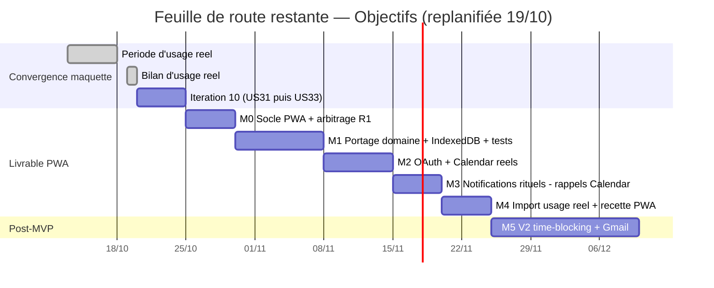

# Pilotage du projet « Objectifs » — Chef de projet technique

**Rôle** : chef de projet technique (intégré au projet le 19/10/2026)
**Mission** : garantir la livraison selon le cahier des charges (US1–US33), dans les délais, le budget (charge) et la qualité attendue par le client.
**Référentiels** : cahier des charges (US1–US33, recettes it. 1–9) ; DAT v1.0 (ADR-01..09, roadmap M0→M5) ; guide de bonnes pratiques dev v1.1 (§5.4 historisation) ; maquette v0.11.0 (schéma v9).

---

## 1. Mode de fonctionnement de l'équipe

### 1.1 Rôles et responsabilités

| Rôle | Tenue par | Responsabilités clés |
| --- | --- | --- |
| Direction de projet / client / utilisateur unique | Mathieu Blandin | Décisions et arbitrages (dont R1), validation des jalons, période d'usage réel |
| Chef de projet technique | agent CPM | Planning, priorisation, charge, reporting, risques, conformité cahier/budget/qualité |
| Responsable technique | agent RT | Qualité, guide de bonnes pratiques (v1.2), revues de code/implémentation, contrôle d'explicité + readiness des US, **conception des évolutions (avec plan de tests unitaires macro)** |
| Architecte logiciel | agent architecte | DAT v1.0, ADR, cohérence architecture cible |
| Analyste métier | agent analyste | Cahier des charges, raffinement des US, **recettes métier et re-recettes (garant de la boucle d'acceptation du cycle v3)** |
| UX/UI | agent UX/UI | Maquette, accessibilité (US31/AA), revues design |
| Développeur | agent dev | **Relecture de la conception avant codage**, implémentation maquette + livrable PWA selon la conception, tests miroir/unitaires |

### 1.2 Rituels et règles de collaboration

- **Revues quadripartites** à chaque document de référence (pattern validé sur le DAT et le guide) : chaque rôle relit selon son axe, retours consolidés, version publiée avec historique tracé.
- **Cycle de développement v3** (évolution du v2, décision client du 20/10/2026, garanti par le RT ; l'analyste métier est garant de la boucle d'acceptation) : raffinement (analyste + UX/UI) → **contrôle d'explicité et validation readiness par le RT** → **conception de l'évolution par le RT** (avec plan de tests unitaires macro) → **relecture de la conception par le développeur** (retours arbitrés par le RT) → **développement selon la conception** → **relecture de code par le RT** → **tests exécutés par le développeur** (boucle de correction jusqu'au vert, rapport de tests) → revue de fin de développement → **recette métier par l'analyste** (parcours des critères d'acceptation + scénarios bout-en-bout + tests des limites ; verdict : Validée / Validée avec réserves / Rejetée) → **si anomalies bloquantes ou majeures : itération de correction d'anomalie** (analyste retourne les points formulés en critères testables → dev corrige → RT relit le code → dev rejoue les tests + les critères rejetés → revue de fin de dev) → **re-recette métier** — la boucle correction/re-recette se répète jusqu'à **acceptation par le métier** (Validée ou Validée avec réserves, les mineures étant listées pour correction ultérieure) ou **point bloquant remonté** : si un désaccord ou une impossibilité persiste (spec incohérente, arbitrage produit requis, dette insoluble dans l'itération), l'analyste consigne le point bloquant, le CPM l'escalade à Mathieu avec options argumentées, et l'US est suspendue jusqu'à arbitrage. Application immédiate : recette R1–R8 de l'itération 10 en cours.
- **Reporting** : executive report quotidien (météo + arbitrages + risques) ; synthèse hebdomadaire complète le lundi ; registres mis à jour en continu (une seule source de vérité, ce document).
- **Historisation** (guide §5.4) : chaque livraison soldée est archivée dans la bibliothèque « Objectifs — Historique des livrables » — une livraison n'est close que lorsque ses livrables sont archivés.
- **Décisions** : les agents proposent des options argumentées ; les arbitrages relevant du client (arbitrage R1, périmètre V2) sont tracés dans le registre des actions avec échéance.

---

## 2. Planning de référence

Établi le 19/10/2026 à partir du DAT §10 (durées arbitrées, jours ouvrés) et de la priorisation du cahier (passe design volontairement en dernier). **Replanifié le 19/10 au soir (décision client : clôture anticipée de la période d'usage réel — incident persistance rendant l'usage impossible) ; l'ensemble de la feuille de route est avancé d'environ deux semaines.**

| Jalon | Dates indicatives | Critère de sortie |
| --- | --- | --- |
| Bilan d'usage réel | **Soldé le 19/10** (clôture anticipée, incident) | Bilan consigné au cahier ; export du dernier état exploitable (A-001) |
| Itération 10 | **20/10 → 26/10** | **Soldée le 20/10** : US31/US33 recettées 8/8, acceptées au premier passage |
| M0 — Socle PWA | **27/10 → 02/11** | Installable navigateur vierge **(mobile ET desktop PC — arbitrage R1 du 20/10)**, build rejouable ; import du dernier export |
| M1 — Portage | **03/11 → 13/11** | Tests verts ; round-trip export/import ; dette revue n°1 remboursée (horloge, aléatoire, dates UTC, localStorage) |
| M2 — Google réel | **16/11 → 24/11** | US14 (c.5) et US1-c2 recettés sur le réel ; OAuth « production » publié (ADR-12, A-010) |
| M3 — Notifications (rappels Calendar) | **25/11 → 01/12** | US11 recetté sur l'appareil cible — rappels Google Calendar natifs (ADR-11) |
| M4 — Recette finale | **02/12 → 08/12** | Import sans perte ; **sortie MVP = recette + 2 semaines d'usage réel documentées sur le livrable PWA (≈ mi-décembre 2026)** |
| M5 — V2 | Après acceptation MVP (~15 j ouvrés) | US8/US10 recettés ; puis V2-S1′ sauvegarde Drive (~2–3 j) → V2-S2′ synchronisation (~3–5 j) — ADR-10 |

---

## 3. Backlog priorisé (restant)

| Priorité | Item | État | Itération/jalon |
| --- | --- | --- | --- |
| 1 | ~~Poursuite de la période d'usage réel~~ **clôturée le 19/10 (décision client — incident persistance)** | Clôturée | — |
| 2 | Bilan d'usage réel — **soldé le 19/10** ; export du dernier état (A-001) à faire aujourd'hui | Soldé | Bilan 19/10 |
| 3 | US31 — Ergonomie tactile et accessibilité de base (44 px, libellés, contraste AA) | À faire | Itération 10 |
| 4 | US33 — Durées lisibles h/min, états vides guidés, accueil de première utilisation | À faire | Itération 10 |
| 5 | M0 → M4 : socle PWA, portage, Google réel, notifications, recette finale | À faire | Livrable PWA |
| 6 | US8 — Time-blocking ; US10 — Gmail | En attente acceptation MVP | V2 (M5) |
| 7 | Trajectoire distante **actée (D-1 : Option E, 19/10)** : V2-S1′ sauvegarde Drive (~2–3 j) puis V2-S2′ synchronisation (~3–5 j) post-MVP ; notifications rituels via rappels Calendar au M3 (ADR-11) — phasage à re-confirmer au bilan (A-011) | Actée — en attente post-MVP | Post-MVP / M3 |

Arbitrage en attente : ~~**R1 — stratégie de notifications**~~ **tranché le 20/10 par Mathieu : PWA confirmée (pas de TWA), notifications des rituels via rappels Google Calendar (ADR-11, M3), et portabilité exigée sur navigateur de PC** — l'application est un logiciel de productivité utilisable au bureau comme en mobilité. Aucun arbitrage en attente.

---

## 4. Registre des actions (source unique de vérité)

| ID | Description | Responsable | Échéance | Priorité | Statut |
| --- | --- | --- | --- | --- | --- |
| A-001 | Export du dernier état exploitable des données (session courante — les sessions antérieures sont perdues, stockage inaccessible) | Mathieu | 19/10/2026 | Haute | **Soldé — export réalisé** ; servira d'import de référence au M0 |
| A-002 | Consigner le bilan d'usage réel — **clôture anticipée le 19/10 (décision client) : bilan consigné au cahier** | Mathieu + analyste métier | 19/10/2026 | Haute | **Terminée le 19/10** (bilan consigné ; validation Mathieu en synthèse) |
| A-004 | Lancer l'itération 10 (US31 élargie puis US33) — **avancée au 20/10 (décision client)**, première application du cycle de développement v3 | CPM + RT + dev + UX/UI | **20/10/2026** | Haute | **Terminée le 20/10** — v0.12.0 livrée (TM 11/11) puis **recette métier R1–R8 : 8/8 conformes, US31/US33 validées sans anomalie, itération soldée et acceptée** |
| A-005 | Archiver chaque livraison dans la bibliothèque d'historisation | Responsable de la livraison (contrôle RT en revue de fin) | À chaque livraison | Moyenne | En cours |
| A-006 | Rembourser la dette de la revue d'implémentation n°1 (horloge injectée, aléatoire hors domaine, dates locales, `localStorage` via port) au portage | Développeur (revue RT) | 26/11/2026 (M1) | Moyenne | À faire |
| A-007 | Executive report quotidien + synthèse hebdomadaire | CPM | quotidien / lundi | Moyenne | En cours |
| A-008 | Vérifier la présence des archivages en revue de fin de développement | Responsable technique | À chaque itération | Moyenne | En cours |
| A-010 | Publier l'écran de consentement OAuth Google « En production » au M2 (sinon jetons expirant tous les 7 jours — ADR-12 du DAT v1.1) | Développeur | M2 (04/12/2026) | Haute | À faire |
| A-011 | Re-confirmer/affiner le phasage V2 au bilan — **soldé le 19/10 (bilan anticipé) : phasage V2 maintenu sans changement** | Mathieu | 19/10/2026 | Moyenne | **Terminée le 19/10** |
| A-012 | **Incident persistance (19/10)** : recetter le garde-fou **v0.11.2** (bannière visible à l'ouverture, événement « stockage » au journal, round-trip export/import US23) puis solder la recette au cahier | Mathieu | 22/10/2026 | **Haute** | **Annulée (décision client)** — usage réel clos et export A-001 sécurisé ; les garanties correspondantes (persistance, bannière) seront recettées sur le livrable PWA au M0 |
| A-014 | **Réserves de recette M0** : héberger le socle `objectifs-pwa` en HTTPS statique, puis vérifier en navigateur réel — invite d'installation Chrome/Edge desktop **et** Chrome Android, chargement hors ligne, persistance fermeture/réouverture avec import de l'export A-001 (r1–r3 de la recette US34) | Mathieu | 02/11/2026 | Haute | **En cours (03/11)** : mise en ligne faite via le workflow GitHub Actions (run 41675966513 vert ; URL `https://mathieublandin-create.github.io/objectifs-pwa/` répond HTTP 200). Recette réelle : **r1 ✔ install desktop/mobile OK, r2 ✔ démarrage hors ligne OK, r3 ⏸ en attente** — pas de création de données possible au M0 (accueil lecture seule) ; r3 à rejouer avec l'import de l'export A-001, ou au M1 |
| A-015 | **BDD v5** : rédiger les `.feature` du périmètre MVP (US3–US14) pour la non-régression fonctionnelle du portage M1 | Analyste métier | 13/11/2026 | Haute | À faire |
| A-013 | **Incident persistance (19/10)** : appliquer le protocole export/import US23 à chaque session d'usage réel jusqu'au bilan (export avant fermeture, import à la réouverture) | Mathieu | 27/10/2026 | **Haute** | En cours |
| A-016 | **Migration du développement vers Vibe Code (décision client du 03/11)** : reprise du projet dans Vibe Code — prompt de reprise complet + 7 fichiers compagnons (maquette, cahier, DAT, guide, pilotage, guide utilisateur, étude D-1) remis ; le dépôt GitHub `mathieublandin-create/objectifs-pwa` devient la persistance du code et `docs/` des livrables ; le cycle v5, la gouvernance anti-boucles et les actions ouvertes (A-014, A-015, A-006, A-010) sont repris par l'agent Code | Mathieu + agent Code | 03/11/2026 | Haute | **En cours** — livrable remis le 03/11/2026 |

Actions terminées (archivées) :
| ID | Description | Responsable | Terminée le |
| --- | --- | --- | --- |
| A-000 | Intégration du CPM : organisation, registres, planning de référence, première synthèse hebdomadaire | CPM | 19/10/2026 |
| A-003 | Arbitrage R1 (notifications PWA vs TWA) — **clôturée par décision D-2 du 19/10 : rappels Google Calendar (ADR-11, DAT v1.1) ; TWA écartée** | Mathieu | 19/10/2026 |
| A-009 | Décision D-1 : trajectoire de persistance distante — **rendue le 19/10 : Option E (Google Drive + Calendar)** ; DAT v1.1 (ADR-10/11/12) | Mathieu | 19/10/2026 |

---

## 5. Registre des risques et opportunités

| ID | Risque / Opportunité | Gravité / Gain | Probabilité | Tendance | Réponse | Responsable |
| --- | --- | --- | --- | --- | --- | --- |
| R1 | Notifications rituels non garanties en arrière-plan (limites PWA mobiles) | Majeure (périmètre livrable) | Résolue | ↑ | **Clos le 19/10 (décision D-2)** : rappels Google Calendar natifs (ADR-11), implémentation au M3 en continuité de M2 ; TWA écartée. **Arbitrage final rendu le 20/10 par Mathieu** : PWA confirmée, notifications via rappels Google Calendar — **l'application doit aussi être portable sur navigateur de PC** (exigence M0 : installable et fonctionnelle sur navigateur desktop, pas seulement mobile) | Développeur |
| R2 | Données locales uniquement (perte = tout perdu) — **partiellement réalisé le 19/10 : stockage éphémère du runtime détecté (incident bloquant usage réel)** | Majeure | **Réalisée (partiel)** | ↑ | **Hotfix v0.11.1 (19/10)** : sonde de persistance + bannière d'avertissement + trace US22 ; pont export/import US23 à chaque session (A-013) ; remède définitif = persistance distante Option E (ADR-10, post-MVP) | Mathieu + dev |
| R3 | Double travail design si US31/33 trop tôt | Modérée | Faible | ↓ | Passe design en dernier après restructuration US27/32 (positionnement figé au cahier) | CPM |
| R4 | Dérive du bilan d'usage réel si observations non consignées | Modérée | Moyenne | = | Journal de diagnostic in-app (US22) + export 27/10 | Mathieu |
| O1 | Domaine pur testé (54/54) : portage M1 sécurisé, risque faible de régression | Gain (planning) | Élevée | ↑ | Transposition directe ADR-04, tests transplantés en M1 | RT + dev |
| O2 | Bibliothèque d'historisation : mémoire consultable du projet, accélère recettes et revues | Gain (efficacité) | Élevée | ↑ | Convention §5.4 appliquée dès le 19/10 | CPM |
| O3 | Bilan du 27/10 peut relever des besoins V2 précoces (backlog post-MVP) | Gain (produit) | Moyenne | = | Analyser le journal de diagnostic au bilan | Analyste |

---

## 6. Suivi de charge

- **Capacité** : équipe d'agents mobilisée à la demande ; le facteur limitant est la disponibilité de Mathieu (direction, arbitrages, usage réel, recettes).
- **Semaine du 13 au 19/10** : charge concentrée sur le RT (guide v1.0→v1.1, revue d'implémentation n°1) et le CPM (mise en place du pilotage) ; période d'usage réel non perturbée — aucune surcharge constatée.
- **Semaine du 20 au 26/10** : charge légère — poursuite de l'usage réel seule ; préparer l'export et le bilan (A-001/A-002).
- **Alerte charge à venir** : les semaines du 27/10 au 05/11 concentrent bilan + itération 10 (US31 puis US33) ; les agents UX/UI et dev seront sollicités en continu — pas de surcharge prévisible côté agents, vigilance sur la disponibilité de Mathieu pour les recettes.

---

## 7. Synthèses hebdomadaires

### Synthèse n° 1 — semaine du 13 au 19/10/2026 (établie le 19/10/2026)

**Météo projet : ☀️ Ensoleillé — tendance ↑** (première synthèse ; situation nominale sur tous les axes, semaine la plus dense en livrables depuis l'itération 9).

**Vue calendaire**
- Itération 9 soldée le 13/10 : US27 (fiche d'édition, garde cycle strict) et US32 (rangées allégées) recettées — maquette v0.11.0, schéma v9, tests miroir 54/54.
- DAT v1.0 validé le 19/10 après revue quadripartite (9 ADR, roadmap M0→M5, verdicts sans objection bloquante).
- Guide de bonnes pratiques v1.0 publié puis v1.1 le même jour (revue quadripartite + convention d'historisation §5.4) ; revue d'implémentation n°1 soldée : **conforme, aucun constat bloquant**, dette tracée pour M1.
- Historisation opérationnelle : bibliothèque « Objectifs — Historique des livrables » créée, 4 livrables versionnés archivés.
- Position vs planning : période d'usage réel en cours (fin le 27/10), conforme au plan ; trajectoire MVP inchangée (recette ~18/12, sortie MVP ≈ début janvier 2027).

**Vue budget (charge)**
- Budget suivi en charge de travail, infrastructure à coût nul (ADR-01). Semaine écoulée : consommation conforme aux prévisions (itération 9 + quatre documents de référence + mise en place du pilotage). Aucun écart, prévision à terminaison inchangée (bilan 3 j + itération 10 : 5 j + M0–M4 : 32 j ouvrés, M5 15 j post-MVP).

**Backlog & priorisation**
- Livrées : US27, US32. En attente : US31 puis US33 (itération 10, après bilan — positionnement figé pour éviter le double travail). Arbitrage attendu : **R1 avant le 12/11**.

**Équipe & charge**
- Aucun blocage. RT chargé (guide + revues) — soldé. CPM intégré (ce document = source de vérité du pilotage). Vigilance : disponibilité de Mathieu pour les recettes de l'itération 10 et l'arbitrage R1.

**Risques & opportunités** : registre initialisé (§5) — R1 notifications (=, échéance fin M0), R2 données locales (=, export 27/10), O1 portage M1 sécurisé (↑).

**Addendum au soir du 19/10 — incident bloquant & hotfix** : Mathieu signale la **réinitialisation des données entre deux ouvertures** de la maquette (R2 partiellement réalisé : stockage éphémère du runtime, code non fautif). **Hotfix v0.11.1 livré le jour même** (garde-fou : sonde, bannière ambre, trace US22 ; tests 11/11) — la maquette reste utilisable en usage réel via le pont export/import US23 (A-013). **Météo revue : ⛅ Variable** — situation corrigée mais vigilance renforcée : le bilan du 27/10 (A-001/A-002) portera sur des sessions discontinues, et la valeur du critère de sortie « sans perte de données » sera appréciée à l'aune de l'incident (dérogation consignée au cahier). Aucun impact calendaire prévu (M0 démarre le 06/11) ; impact résiduel = charge utilisateur accrue à chaque session (export/import manuels) jusqu'à la persistance distante (Option E, post-MVP). **Correctif du correctif (soir même)** : la v0.11.1 plantait elle-même au démarrage (seul accès non gardé au stockage — `SecurityError` possible à la seule lecture dans le bac à sable, écran blanc) ; **v0.11.2** livrée le soir même, accès entièrement gardé, tests miroir 8/8 ; cause racine affinée : stockage **inaccessible** (et non éphémère), masqué depuis l'origine par les `try/catch` silencieux. Météo maintenue ⛅ — recette A-012 à passer sur la v0.11.2. **v0.11.3 (soir même)** : régression latente de l'itération 9 corrigée (`vel` manquant au Rituel — tri US30 ; tests miroir 54/54 de l'ité. 9 n'avaient pas couvert le câblage JSX, seulement le domaine) ; leçon intégrée au guide v1.2 : la conception RT inclura désormais le câblage des composants dans le plan de tests macro. Météo revue **⛅ (stable)** — trois correctifs le même jour révèlent une fragilité de la maille UI/domaine, entièrement traitée ; la recette A-012 cible désormais la v0.11.3.

**Executive report du 19/10 au soir — clôture anticipée (décision client)** :
- **Météo : ⛅ → ↑ en amélioration** — l'usage réel impossible sur la maquette (stockage inaccessible) ne bloque plus rien : période clôturée, bilan soldé, feuille de route avancée de ~2 semaines (itération 10 dès le 20/10, M0 le 27/10, sortie MVP ≈ mi-décembre 2026 sous réserve des 2 semaines d'usage réel sur le livrable).
- **Avancement** : bilan d'usage réel consigné au cahier (motif, observations, dérogation au critère « 2 semaines sans perte » reportée sur le livrable PWA, décisions) ; replanification complète ; phasage V2 confirmé (A-011 soldé).
- **Arbitrages prioritaires** : 1) A-001 — export du dernier état **aujourd'hui** avant fermeture (Haute) ; 2) recette H1–H5 des correctifs v0.11.x (Haute, A-012) ; 3) lancement itération 10 demain 20/10 (A-004) — contrôle d'explicité US31/US33 élargies par le RT en ouverture de cycle v2.
- **Risques/opportunités** : R2 realized-partiel → remède définitif Option E confirmé (ADR-10) ; O4 (nouvelle) : replanification offre ~2 semaines de marge sur la trajectoire MVP — gain planning, tendance ↑.

**Actions** : registre initialisé (A-001 à A-008, §4). Plan de la semaine suivante (20–26/10) : poursuite de l'usage réel ; préparation de l'export et du bilan du 27/10 ; aucun développement (aucune modification de la maquette pendant l'observation).

**Suivi du 20/10 (décisions client)** :
- **A-001 soldé** — export du dernier état réalisé par Mathieu ; il servira d'import de référence au M0.
- **A-012 annulée** — la recette H1–H5 des correctifs v0.11.x n'est plus nécessaire (usage réel clos, export sécurisé) ; les garanties de persistance et la bannière seront recettées sur le livrable PWA au M0.
- **Workflow de développement v4 (guide v1.4)** : après la conception du RT, **l'architecte logiciel valide la conception avant le développement** (conformité DAT/ADR, verdict Conformité / Conformité avec réserves / Non conforme) ; le reste du cycle v3 (dont la boucle d'acceptation métier) est inchangé. Première application : M0 (27/10).
- **Historisation quotidienne (guide v1.5)** : toute spécification modifiée dans la journée est archivée le jour même en fin de session (un snapshot par livrable et par jour) ; l'archivage à chaque livraison soldée reste en vigueur. Application immédiate.
- Aucun impact calendaire ; M0 démarre le 27/10 avec l'ensemble des prérequis disponibles (arbitrage R1 rendu, export A-001, cycle v4 en vigueur).

**Suivi du 20/10 au soir — cycle v4 exécuté intégralement sur le M0 (lancement avancé à la demande de Mathieu)** :
- **Première application du cycle v4** : raffinement US34 (analyste) → contrôle d'explicité RT (verdict « prêt », I1–I5) → conception RT en 7 lots + plan TM1–TM12 → **validation architecte (« Conformité avec réserves », ADR-13 : build Node zéro dépendance au M0, DAT v1.2)** → relecture dev (1 retour) → développement → revue de code RT (2 constats corrigés) → tests 11/11 → revue de fin de dev → **recette métier : US34 Validée avec réserves** (9/9 critères conformes ou conformes par analyse statique ; aucune anomalie bloquante/majeure).
- **Livrable `objectifs-pwa` v0.13.0-m0** (multi-fichiers, schéma v9) : build rejouable, manifeste, SW cache versionné, persistance gardée, import/export « objectifs-donnees-v1 », accueil lecture seule. Le M0 est **livré en avance** (20/10 pour un jalon 27/10–02/11) — **marge calendaire gagnée sur le jalon**, M1 (portage) peut être engagé dès validation des réserves.
- **Réserves de recette (vérifications en conditions réelles, A-014)** : hébergement HTTPS puis invite d'installation desktop + mobile, chargement hors ligne, persistance fermeture/réouverture avec import de l'export A-001.
- **Nouvelle action A-014** (voir registre) : mise en ligne du socle (hébergement statique HTTPS) et vérifications navigateur réel — Mathieu.
- Météo : **☀️ Ensoleillé** — cycle v4 appliqué sans heurt, l'architecte a relevé et arbitré un écart structurel réel (Vite/Workbox → ADR-13), aucun échec de test après revue.
- **Nouveau livrable (décision client)** : **guide utilisateur** créé (v1.0 — installation PC/mobile, mise à jour, export/import, dépannage), avec règle de maintenance consignée au guide dev (§5.4) : mise à jour obligatoire à chaque livraison modifiant l'expérience utilisateur, vérifiée en revue de fin de développement. Historisé comme les autres livrables.

**Suivi du 20/10 — fin de session — cycle v5 : BDD/TDD (décision client)** : l'analyste métier rédige désormais des **scénarios Gherkin** (`.feature` par US) ; le développeur passe en **TDD** (red → green → refactor) ; la suite des `.feature` livrées devient la **non-régression fonctionnelle**, exigée pour déclarer une US **ready** (guide v1.6 §5.1 v5, ADR-14 : runner zéro dépendance, cahier : convention consignée). Première application : `.feature` US34 livrée avec le socle ; **A-015** ouverte : rétro-conversion du périmètre MVP (US3–US14) en `.feature` au lancement du M1 (analyste, 13/11). Gouvernance v2 inchangée (les règles anti-boucles s'appliquent au cycle v5). Aucun impact calendaire prévu (charge absorbée par la marge du M0 livré en avance).

**Incident et restauration (20/10, fin de session) — l'historisation fait ses preuves** : l'environnement d'exécution natif est recréé à chaque session et le dossier projet `objectifs-pwa` (sources + `dist/`) y avait disparu. **Restauration intégrale depuis l'archive quotidienne** de la bibliothèque (« Objectifs — Historique des livrables », snapshot v0.13.0-m0 du 20/10) : 11 fichiers récupérés à l'identique, puis cycle complet vert (11/11 tests unitaires + 5/5 scénarios BDD US34). Leçon : l'archive quotidienne (§5.4) est le **mécanisme de persistance du code** entre sessions ; toute future session de développement restaure depuis la bibliothèque si le dossier est absent. Aucune perte, aucune régression.

**Coordination Jarvis × CPM — gouvernance des échanges v2 (20/10/2026, décision client)** : révision du process de réalisation pour **limiter les échanges IA↔IA et éliminer les boucles infinies**. Diagnostic : le cycle v4 exécuté au M0 a montré la voie (toutes les phases en une session, chaque agent parlant par livrable écrit) ; les risques de boucle résident dans les clarifications croisées entre agents et les demandes humaines au compte-gouttes. **Règles adoptées et ancrées dans l'orchestrateur (Jarvis, 7 règles v2)** : (1) file unique orchestrée — Jarvis route tout, les agents produisent sans s'interpeller directement ; (2) règle de l'écrit — tout échange passe par un livrable, une information manquante devient une interprétation consignée (Ix) et le travail continue ; (3) zéro re-boucle de clarification — les Ix ne sont arbitrées que par l'humain ou en revue de fin de cycle ; (4) plafonds d'itération — 2 allers-retours RT↔dev, 2 rejets recette, au-delà revue à trois + arbitrage humain ; (5) cycle complet en une session sauf points de validation humaine ; (6) budget d'échanges — 3 échanges sans avancement de livrable = cycle stoppé et escalade ; (7) guichet humain groupé — file d'arbitrages unique tenue par le CPM, présentée en lot à chaque point de validation. **Objectif mesurable** : ≤ 1 échange IA↔IA par phase, 0 boucle de clarification ; le compteur d'échanges et les franchissements de plafond sont tracés dans l'executive report. Aucun impact calendaire ni budget.

**Suivi du 03/11 — cycle v6 + gouvernance v3 (décision client, Mathieu)** : évolution du process de réalisation (guide v1.7 §5.1, REPRISE §6) — (1) **revue de lancement RT↔développeur** entre conception validée et codage pour lever les ambiguïtés et aligner les attendus de chaque participant ; (2) **revue d'entrée en test** : après relecture de son code, le développeur présente son travail et le **responsable fonctionnel (analyste métier) juge la recette jouable** avant tests finaux ; (3) en approche TDD, le **responsable fonctionnel écrit les tests Gherkin (`.feature`) dès que l'US est prête à démarrer le dev** (étape readiness) ; (4) l'**orchestrateur adapte le modèle utilisé à chaque rôle** pour une approche efficiente par persona ; (5) **plusieurs développeurs instanciables en parallèle** au besoin, après **vérification préalable du risque de modification des mêmes fichiers**, chacun dans **sa propre feature branch `feat/USxx-…`**. Première application : M1. Aucun impact calendaire prévu.

**Suivi du 03/11 — organisation par lots (décision client, Mathieu)** : les évolutions seront traitées **par lots à périmètre gelé** (2–4 US, gel au lancement), avec une **phase de test utilisateur en conditions réelles entre chaque lot**, timeboxée et planifiée comme jalon par le CPM (guide v1.8 §5.1, REPRISE §7.5). Chaque US du lot conserve le cycle v6 complet et la recette métier par US (analyste) ; le test utilisateur valide le lot en conditions réelles, comme les réserves r1–r3 du M0. **Risques consignés** : délai de détection inter-lots (mitigé par la non-régression BDD à chaque livraison intra-lot), gonflement du périmètre (mitigé par le gel au lancement), disponibilité du testeur unique (mitigé par la planification en jalon), impact calendaire (mitigé par le timebox des phases de test). **Suivi du 03/11 — arbitrage client sur l'organisation par lots (Mathieu)** : décision retenue = **livraison US par US** (cycle v6, non-régression BDD à chaque livraison, merge après tests verts + revue) et **validation humaine par paliers fonctionnels** — une phase de test utilisateur en conditions réelles avec Mathieu lorsqu'un palier fonctionnel est livré, timeboxée et planifiée comme jalon (guide v1.9 §5.1, REPRISE §7.5). Le risque de détection tardive inter-lots consigné en v1.8 est levé ; restent la disponibilité du testeur unique et le coût calendaire des phases de test (mitigés par planification + timebox). Première application : M1.

**Suivi du 03/11 — recette des réserves M0 (A-014), verdict partiel de Mathieu en conditions réelles** : mise en ligne OK (workflow GitHub Actions, run 41675966513 vert ; `https://mathieublandin-create.github.io/objectifs-pwa/` répond HTTP 200 — vérifié par l'agent). **r1 ✔** invite d'installation OK (Chrome/Edge desktop et Chrome Android) ; **r2 ✔** démarrage hors ligne OK ; **r3 ⏸ en attente** — la persistance fermeture/réouverture n'est pas testable tant que la création de données n'existe pas (accueil M0 en lecture seule) ; r3 sera rejouée avec l'import de l'export A-001 (menu ☰ → Importer) ou au M1. Guide utilisateur mis à jour (v1.1) avec l'URL réelle.